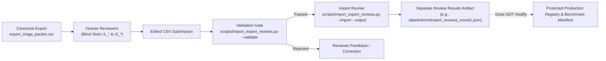

# Expert Review CSV Editing and Import Workflow

> [!IMPORTANT]
> **Document Status**: OPERATIONAL REVIEW IMPORT GUIDE (Stage 3.5.2)  
> **Target Frameworks**: Mission Karmayogi (NPCSCB / CBC) & Ministry of Statistics and Programme Implementation (MoSPI / NSSTA)  
> **Key CLI Utility**: [`scripts/import_expert_reviews.py`](file:///d:/Projects/SIH26101/SIH26101-Skill-Intelligence/scripts/import_expert_reviews.py)  
> **Automated Test Suite**: [`tests/test_import_expert_reviews.py`](file:///d:/Projects/SIH26101/SIH26101-Skill-Intelligence/tests/test_import_expert_reviews.py)

---

## 1. Overview & Architecture

The **Expert Review Import Workflow** provides a secure, validated bridge between human spreadsheet evaluations and machine-readable JSON results.



### Core Architecture Rules:
1. **The CSV is an Export for Review**: The canonical CSV [`data/interim/expert_triage_packet.csv`](file:///d:/Projects/SIH26101/SIH26101-Skill-Intelligence/data/interim/expert_triage_packet.csv) is provided for Subject Matter Experts (SMEs) to inspect course dossiers in standard spreadsheet tools.
2. **Import Generates a Separate Artifact**: Importing does **not** alter the canonical packet, benchmark manifest, or production mapping registry. It writes to a separate, new JSON file.
3. **Refusal to Overwrite**: The import tool strictly refuses to overwrite existing files or core repository assets.

---

## 2. Reviewer Instructions: Editing Designated Columns

Subject Matter Experts must only edit their assigned review columns. All course metadata and source citations are strictly read-only.

### Designated Columns for Human Review:

| Reviewer 1 Columns | Reviewer 2 Columns | Field Description & Instructions |
| :--- | :--- | :--- |
| `r1_reviewer_id` | `r2_reviewer_id` | **Required if evaluating**: Official reviewer code (e.g., `SME-NSSTA-01`). |
| `r1_reviewer_role` | `r2_reviewer_role` | **Optional**: Professional role (e.g., `Senior Faculty, Official Statistics`). |
| `r1_reviewer_affiliation` | `r2_reviewer_affiliation` | **Optional**: Organization (e.g., `NSSTA / MoSPI`). |
| `r1_review_date` | `r2_review_date` | **Optional**: Date in `YYYY-MM-DD` format. |
| `r1_expert_decision_label` | `r2_expert_decision_label` | **Required if evaluating**: Must be strictly one of the 5 approved labels (see below). |
| `r1_expert_target_kcm_id` | `r2_expert_target_kcm_id` | KCM ID (e.g., `KCM-FUNC-11`). Must be blank if declaring a domain gap. |
| `r1_confidence_rating` | `r2_confidence_rating` | **Required if evaluating**: Integer from `1` (Very Low) to `5` (Very High). |
| `r1_expert_rationale` | `r2_expert_rationale` | **Required if evaluating**: Substantive technical justification (minimum 5 characters). |
| `r1_requisition_notes` | `r2_requisition_notes` | **Optional**: Exact curriculum or syllabus documents needed from MoSPI/iGOT. |

### The 5 Approved Decision Labels:
1. `supported_mapping`: Curricular evidence proves alignment with specific KCM competency definition and sub-theme.
2. `plausible_insufficient_evidence`: Topical alignment is plausible, but granular lesson plan is restricted or unmirrored.
3. `incorrect_mapping`: Proposed mapping is factually erroneous or contradicts verified course content.
4. `unresolved_insufficient_source`: Course topic is relevant, but zero verified course documentation exists locally to evaluate it.
5. `no_applicable_kcm_competency`: Course covers specialist official statistics or domain topics unrepresented in KCM 2024.

---

## 3. How to Validate a Review CSV Before Importing

Before generating an import artifact, run the validator in validation-only mode. This checks all 26 cases without modifying or creating any files.

### Windows Command:
```powershell
python scripts/import_expert_reviews.py --validate data/interim/expert_triage_packet.csv
```

### Validation Pass Output:
```text
======================================================================
MoSPI SIH26101: Validating Expert Review CSV Submission
Target CSV: data\interim\expert_triage_packet.csv
======================================================================

[VALIDATION PASSED] All 26 cases satisfy data integrity and review contract.
  - Cases with Reviewer 1 completed: 26 / 26
  - Cases with Reviewer 2 completed: 26 / 26
  - Cases with Provisional Consensus: 22
  - Cases with Reviewer Conflict: 4
  - Immutable Metadata & Source Provenance: 100% UNTOUCHED

File is ready for import via --import <csv> --output <path>.
```

---

## 4. How to Import to a New Review-Results File

Once validation passes, import the reviews into a new JSON artifact. The output file must not already exist.

### Windows Command:
```powershell
python scripts/import_expert_reviews.py --import data/interim/expert_triage_packet.csv --output data/interim/expert_reviews_round1.json
```

### Safety Features of the Import CLI:
- **Refusal to Overwrite Existing Output**: If `expert_reviews_round1.json` exists, the CLI exits with error code 1.
- **Refusal to Overwrite Canonical Files**: The tool strictly refuses to overwrite `expert_triage_packet.json`, `acbp_courses.json`, `competencies_kcm.json`, or `acbp_kcm_mappings.json`.
- **Protected Directories**: Any attempt to write inside `data/raw/` or `data/processed/` is rejected as a security violation.

---

## 5. Understanding Consensus Statuses

The import runner evaluates the relationship between Reviewer 1 and Reviewer 2:

| Consensus Status | Meaning | Action Taken |
| :--- | :--- | :--- |
| **`pending_reviews`** | Neither reviewer has submitted an evaluation. | Case remains in triage. |
| **`single_review_in_progress`** | Exactly one reviewer has submitted an evaluation. | Status is `review_in_progress`. A single reviewer **never** establishes consensus or ground truth. |
| **`provisional_consensus_achieved`** | Both reviewers submitted matching labels and matching target KCM IDs. | Recorded as **provisional consensus** in the review artifact. Does **not** alter the production registry. |
| **`conflict_escalated`** | Reviewers submitted conflicting labels (e.g. `supported_mapping` vs `incorrect_mapping`) or conflicting KCM IDs. | Flagged as `requires_more_evidence` for joint NSSTA/MoSPI SME panel resolution. Decisions are never silently merged. |

---

## 6. How to Correct a Rejected File

If `--validate` fails, review the numbered error messages:

1. **"Tampering detected in BM-CASE-XXX: field 'course_name' modified..."**:
   - Cause: A read-only column was altered in the spreadsheet.
   - Fix: Restore the exact text from the original export. Reviewers must only edit columns starting with `r1_` or `r2_`.
2. **"Illegal evidence escalation in BM-CASE-XXX..."**:
   - Cause: `evidence_verification_status` was changed from `external_reference_unverified` to `verified_local_source`, or `is_exact_course_evidence` was set to `True`.
   - Fix: Restore the canonical evidence status. External evidence can only be verified by committing physical PDFs to `data/raw/` and registering them in `source_register.json`.
3. **"Incomplete Reviewer 1 submission in BM-CASE-XXX..."**:
   - Cause: A decision label was selected, but `reviewer_id`, `confidence_rating`, or `expert_rationale` was left blank.
   - Fix: Complete all four mandatory fields for that review slot.
4. **"Malformed Reviewer 1 confidence_rating in BM-CASE-XXX..."**:
   - Cause: Confidence was entered as text (e.g., "High") or a number outside 1–5.
   - Fix: Enter an integer from 1 to 5.
5. **"Duplicate benchmark_case_id..." / "Case count mismatch..."**:
   - Cause: Rows were added, deleted, or re-labeled in Excel.
   - Fix: Ensure all 26 cases `BM-CASE-001` through `BM-CASE-026` are present exactly once.

---

## 7. Known Limitations & Governance Boundaries

1. **Non-Authentication of Reviewer Identities**:
   Reviewer names, roles, and affiliations entered in the CSV are recorded as declarative reviewer metadata. They do **not** constitute cryptographically authenticated institutional approval.
2. **Provisional Consensus is Not Benchmark Ground Truth**:
   Provisional consensus recorded in an imported review artifact is an intermediate analytical finding. Final benchmark ground truth requires formal NSSTA / MoSPI Capacity Building Unit sign-off.
3. **Production Mapping Registry Immutability**:
   The production mapping registry ([`data/processed/acbp_kcm_mappings.json`](file:///d:/Projects/SIH26101/SIH26101-Skill-Intelligence/data/processed/acbp_kcm_mappings.json)) remains completely unaffected by triage packet imports.
