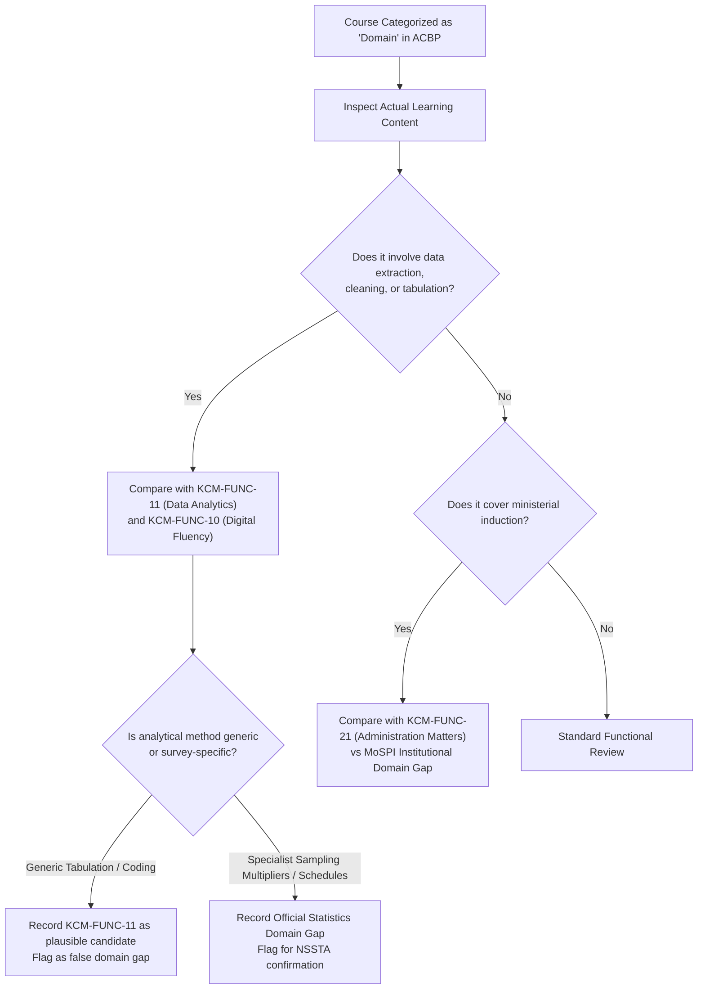
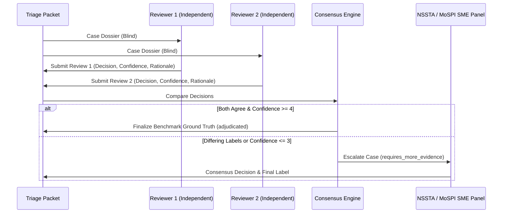

# MoSPI ACBP to KCM Competency Mapping: Expert Triage Guide

> [!IMPORTANT]
> **Document Status**: OPERATIONAL EXPERT TRIAGE GUIDE (Stage 3.5)  
> **Target Frameworks**: Mission Karmayogi (NPCSCB / CBC) & Ministry of Statistics and Programme Implementation (MoSPI / NSSTA)  
> **Machine-Readable Triage Artifacts**:  
> - Expert Triage Packet (JSON): [`data/interim/expert_triage_packet.json`](file:///d:/Projects/SIH26101/SIH26101-Skill-Intelligence/data/interim/expert_triage_packet.json)  
> - Expert Triage Packet (CSV): [`data/interim/expert_triage_packet.csv`](file:///d:/Projects/SIH26101/SIH26101-Skill-Intelligence/data/interim/expert_triage_packet.csv)  
> - Packet Generation Script: [`scripts/build_expert_triage_packet.py`](file:///d:/Projects/SIH26101/SIH26101-Skill-Intelligence/scripts/build_expert_triage_packet.py)  
> - Automated Regression Tests: [`tests/test_expert_triage_packet.py`](file:///d:/Projects/SIH26101/SIH26101-Skill-Intelligence/tests/test_expert_triage_packet.py)

---

## 1. Purpose & Triage Scope

This guide establishes the standardized instructions for **Subject Matter Experts (SMEs)**, curriculum evaluators, and senior statistical training officers conducting **expert triage** on the 26-case pilot competency-mapping benchmark.

### What is Expert Triage vs. Definitive Adjudication?
- **Expert Triage (Stage 3.5)**: The expert reviews the available course identity, institutional documentation, candidate competency options, and potential overlaps. The expert determines whether the proposed alignment is plausible, identifies alternative competency candidates, evaluates potential domain gaps, and records the exact missing curriculum evidence required for definitive resolution.
- **Definitive Adjudication (Future Milestone)**: Final, legally defensible competency certification that assigns permanent benchmark ground truth. This step remains **blocked** for 23 of the 26 cases until the exact course syllabi, video transcripts, or assessment rubrics are legitimately acquired and inspected.

### Core Philosophy
1. **Evidence Quality Over Mapping Coverage**: In official statistics capacity building, forcing an unevidenced competency mapping distorts civil service training pathways, conceals critical competency gaps, and undermines national data quality. An unresolved case is vastly superior to a forced, unevidenced mapping.
2. **The Conflation Safeguard (Four Non-Negotiable Distinctions)**:
   Experts must strictly distinguish:
   - *A subject being relevant to a competency* (topical overlap)
   - *A course explicitly teaching that competency* (instructional focus)
   - *A course developing competency to a particular depth* (pedagogical level)
   - *A learner actually possessing that competency* (individual assessment outcome)
3. **Four Distinct Concepts (Never Conflate)**:
   - **Model / Curator Suggestion**: Algorithmic or heuristic candidate identified during initial discovery.
   - **Triage Guidance Label**: Non-authoritative advisory label prepared by data curators to assist the reviewer.
   - **Independent Expert Decision**: Reasoned evaluation recorded by an authorized subject-matter expert in Reviewer Slot 1 or 2.
   - **Benchmark Ground Truth**: Consensus, binding label finalized after dual review or panel escalation.

---

## 2. Benchmark Label Taxonomy

Evaluators must choose strictly from the five approved benchmark labels:

| Benchmark Label | Strict Definition | Permitted Target KCM ID | Required Evidence Tier |
| :--- | :--- | :--- | :--- |
| **`supported_mapping`** | Verifiable curricular evidence proves direct alignment with a specific KCM competency definition and behavioral sub-theme. | Mandatory (`KCM-BEH-*` or `KCM-FUNC-*`) | Level 3 (Granular session outline) or Level 4 (Observable assessment rubrics) |
| **`plausible_insufficient_evidence`** | Course title or institutional summary plausibly aligns, but exact micro-course syllabus is unmirrored, restricted behind SSO, or too brief to prove competency depth. | Mandatory candidate ID | Level 1 (Title/metadata) or Level 2 (High-level calendar summary) |
| **`incorrect_mapping`** | Proposed mapping is factually erroneous, misaligned in scope, or contradicts verified course content. | Null or Rejected ID | Verifiable contradictory evidence citation |
| **`unresolved_insufficient_source`** | Course covers administrative, behavioral, or statistical topics, but zero verified course documentation exists locally to evaluate it. | Null | Formal notation of missing curriculum |
| **`no_applicable_kcm_competency`** | Course covers specialist official statistics, survey methodology, or domain topics completely unrepresented in the generic KCM 2024 model. | Must be `null` | Verified source evidence establishing an official statistics domain gap |

---

## 3. Strict Protocol for Domain-Category Courses

Courses categorized as **`Domain`** in MoSPI's ACBP schedule (Strata D, e.g., HCES, ASI, Big Data, Python/R, Know Your Ministry) require rigorous review safeguards:

### Mandatory Rules for Domain Courses:
1. **Never Auto-Infer Domain Gap from ACBP Category Header**:
   - Several courses categorized as "Domain" in the ACBP schedule were created by NeGD/MeitY or NSSTA for general civil servants (e.g., `ACBP-CRS-001` *Introduction to Big Data in Governance* and `ACBP-CRS-072` *Introduction to R and Python Programming*).
   - These courses teach general digital fluency and data analysis skills that align directly with `KCM-FUNC-10` (*Digital Fluency*) and `KCM-FUNC-11` (*Data Analytics*).
   - Reviewers must evaluate actual subject matter, not the ACBP category header.
2. **Microdata Tabulation vs. Survey Methodology Distinction (HCES & ASI)**:
   - For `ACBP-CRS-067` (*Handling Unit Level Data of Household Consumption Expenditure Survey*) and `ACBP-CRS-069` (*Handling Unit Level Data of Annual Survey of Industries*):
     - **Generic Analytics Overlap**: Reading unit-level ASCII/CSV data, variable filtering, merging schedule blocks, and computing aggregate tabulations share direct conceptual overlap with `KCM-FUNC-11` (*Data Analytics*).
     - **Specialist Domain Knowledge**: NSS sampling design (strata, sub-strata, FSU/SSU), sampling weights / multipliers, multiplier adjustment formulas, item-level consumption aggregation, and Annual Survey of Industries (ASI) factory accounting schedules represent specialist official statistics domain knowledge.
   - **Triage Action**: Reviewers must preserve the dual hypothesis: determine whether the course teaches generic statistical data handling (`KCM-FUNC-11`) or specialized survey estimation methodology (`no_applicable_kcm_competency`), or a hybrid requiring an official statistics domain extension.

---

## 4. Confidence Rating Scale (1 to 5)

Every expert review card must record an anchored confidence rating:

| Rating | Tier | Evidentiary Criteria |
| :---: | :--- | :--- |
| **1** | **Very Low** | Speculative or title-only evidence; no syllabus, session outline, or learning objectives available. |
| **2** | **Low** | Related institutional publication catalogued, but exact online micro-course module outline is unverified. |
| **3** | **Moderate** | Apex academy classroom curriculum verified (e.g. ISTM, NSSTA), but course duration, delivery modality, or audience differs from online micro-course. |
| **4** | **High** | Granular course session outline verified with direct alignment to specific KCM sub-theme indicators, but lacking assessment data. |
| **5** | **Very High** | Complete syllabus with observable behavioral learning outcomes, practical exercises, and formative/summative assessment criteria verified. |

---

## 5. Dual Independent Reviewer Workflow

To guarantee legal defensibility and eliminate individual reviewer bias, the benchmark protocol enforces dual independent review:

### Reviewer Workflow Rules:
1. **Blind Evaluation**: Reviewer 1 and Reviewer 2 must complete their evaluation slots independently without viewing each other's decisions or rationale.
2. **Mandatory Dual Review Cases**:
   - All 6 title-reference candidate cases (Strata A).
   - All 5 domain-gap and statistical courses (Strata D).
   - Any case assigned confidence rating $\le 3$.
   - Any case where a candidate competency is rejected (`incorrect_mapping`).
3. **Disagreement Escalation**: If Reviewer 1 and Reviewer 2 select differing benchmark labels, the case status becomes `requires_more_evidence` and is referred to a joint NSSTA / MoSPI expert panel for binding resolution.

---

## 6. How to Use the Triage Packets

The triage data is distributed in two synchronized formats:
- **JSON**: [`data/interim/expert_triage_packet.json`](file:///d:/Projects/SIH26101/SIH26101-Skill-Intelligence/data/interim/expert_triage_packet.json)
- **CSV**: [`data/interim/expert_triage_packet.csv`](file:///d:/Projects/SIH26101/SIH26101-Skill-Intelligence/data/interim/expert_triage_packet.csv)

### Field Guide for Reviewers (JSON & CSV):

| Column / Key | Instructions for Reviewer |
| :--- | :--- |
| `benchmark_case_id` | Unique case identifier (`BM-CASE-001` to `BM-CASE-026`). |
| `course_name` | Exact course title from MoSPI ACBP schedule. |
| `primary_source_citation` | Authoritative source location in raw ACBP schedule (Annexure I). |
| `candidate_kcm_id` | Proposed KCM competency ID under review (or `null` if domain gap). |
| `potential_competency_overlaps` | Summary of alternative competencies and conceptual overlaps (e.g. Data Analytics vs Domain Gap). |
| `verified_evidence_summary` | Summary of facts verified from local physical documents. |
| `unverified_evidence_summary` | Summary of missing documents (e.g. exact iGOT module outline). |
| `sme_adjudication_questions` | Specific policy/curriculum questions requiring expert judgment. |
| **Reviewer Decision Fields** | **Fill only your assigned slot (`r1_*` or `r2_*` in CSV; `independent_reviews[0]` or `[1]` in JSON):** |
| `r1_reviewer_id` | Your designated reviewer code (e.g., `SME-NSSTA-01`). |
| `r1_reviewer_role` | Your official role / specialization (e.g., `Senior Faculty, NSSTA`). |
| `r1_reviewer_affiliation` | Your institutional affiliation (e.g., `NSSTA / MoSPI`). |
| `r1_review_date` | Date of evaluation in ISO format (`YYYY-MM-DD`). |
| `r1_expert_decision_label` | Choose strictly from the 5 approved benchmark labels. |
| `r1_expert_target_kcm_id` | Valid KCM ID (e.g. `KCM-FUNC-11`), or leave blank if `no_applicable_kcm_competency`. |
| `r1_confidence_rating` | Integer from `1` (Very Low) to `5` (Very High). |
| `r1_expert_rationale` | Detailed technical justification for your decision. |
| `r1_requisition_notes` | Specific curriculum documents required from MoSPI/iGOT to finalize adjudication. |

> [!CAUTION]
> **Data Integrity Warning**: Reviewers must not alter pre-populated case metadata, course titles, source citations, or hash values. All automated mapping decisions and benchmark labels must remain blank until human evaluation is recorded.
