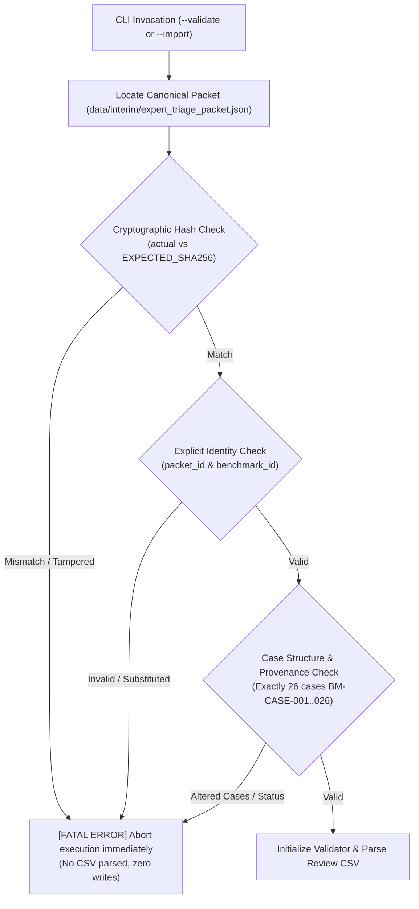

# Stage 3.5.3 — Final Importer Hardening and Review Workflow Freeze Report

**Platform**: SIH26101 Official Statistics Competency Intelligence and Adaptive Learning Platform  
**Stage**: 3.5.3 — Final Importer Hardening and Review Workflow Freeze  
**Evaluation Scope**: Review Import Tooling (`scripts/import_expert_reviews.py`), Canonical Packet Baseline Verification, Input/Output Safeguards, Regression Tests (`tests/test_import_expert_reviews.py`), and Workflow Freeze Recommendation  
**Audit Date**: October 2026  
**Auditor**: Independent Pipeline Quality & Security Agent  
**Key Deliverables**:
- Hardened CLI Tool: [`scripts/import_expert_reviews.py`](file:///d:/Projects/SIH26101/SIH26101-Skill-Intelligence/scripts/import_expert_reviews.py)
- Hardened Regression Suite: [`tests/test_import_expert_reviews.py`](file:///d:/Projects/SIH26101/SIH26101-Skill-Intelligence/tests/test_import_expert_reviews.py) (24 passing tests)
- Workflow Freeze Report: [`docs/stage_3_5_3_workflow_freeze_report.md`](file:///d:/Projects/SIH26101/SIH26101-Skill-Intelligence/docs/stage_3_5_3_workflow_freeze_report.md)

---

## 1. Audit Verdict

### **Verdict: PASS WITH LIMITATIONS**

- **Canonical Packet Integrity & Baseline Verification**: **PASS**  
  `scripts/import_expert_reviews.py` enforces explicit canonical packet identity (`packet_id == "EXPERT-TRIAGE-PACKET-MOSPI-2026-V1"`, `benchmark_id == "BM-PILOT-MOSPI-2026-V1"`) and validates the canonical JSON against its frozen cryptographic baseline hash (`ad2c517b2fca7aff5e26f455b38609f1a65f010f4c0ad9926af480d6825bc8db`). Any alteration, substitution, or corruption of the canonical packet causes an immediate fatal initialization abort before any CSV rows are parsed or files written.
- **Input & Output Safeguards**: **PASS**  
  Output files targeting existing paths, canonical protected files (`expert_triage_packet.json`, `expert_triage_packet.csv`, `source_register.json`, etc.), or protected directories (`data/raw/` and `data/processed/`) are strictly blocked. Validation-only mode (`--validate`) produces zero disk writes. Import mode (`--import`) validates the entire submission before opening the output destination, executes writes via temporary files (`.tmp_<pid>`), and atomically replaces the target, preventing partial or corrupted artifacts.
- **Review Decision Semantics & Immutability Firewall**: **PASS**  
  All 43 non-reviewer columns are strictly immutable; any attempted CSV edit to course metadata, source citations, evidence verification statuses, or final adjudication labels is rejected. Reviewer submissions require valid taxonomy labels, 1–5 integer confidence ratings, and substantive rationales. Single reviews yield `single_review_in_progress`. Disagreements are surfaced as `conflict_escalated`. Agreement produces `provisional_consensus_achieved`, explicitly distinguished from finalized benchmark ground truth and production mappings.
- **Core Baseline Immutability**: **PASS**  
  All three frozen SHA256 hashes (`acbp_courses.json`, `competencies_kcm.json`, `acbp_kcm_mappings.json`) match authoritative baselines. 0 files modified in `data/raw/` or `data/processed/`.
- **Documented Operational Limitations**:  
  Human reviewer names and affiliations entered in the CSV are declarative reviewer metadata and do not constitute cryptographically signed institutional certificates (e.g. NIC e-Sign / PKI). Provisional reviewer consensus is not legally or institutionally binding on MoSPI, NSSTA, or CBC, and cannot bypass the joint expert panel reconciliation required for disputed or under-evidenced cases.

---

## 2. Canonical Packet Integrity Mechanism

The import CLI enforces a multi-layer integrity mechanism to ensure that the review importer never trusts an arbitrary, altered, or substituted canonical packet:



### Technical Details of Integrity Checks:
1. **Explicit Identity Constants**:
   - `EXPECTED_PACKET_ID`: `"EXPERT-TRIAGE-PACKET-MOSPI-2026-V1"`
   - `EXPECTED_BENCHMARK_ID`: `"BM-PILOT-MOSPI-2026-V1"`
   - `EXPECTED_CANONICAL_PACKET_SHA256`: `ad2c517b2fca7aff5e26f455b38609f1a65f010f4c0ad9926af480d6825bc8db`
   - `EXPECTED_CANONICAL_CSV_SHA256`: `fddefbd67a9a6d1af9a3076cd2d5692e3b3cc49820ed8c0cecc3dd6dfa0b6060`
2. **Provenance Rules Verification**:
   - Upon initialization, the validator verifies that `BM-CASE-021`, `BM-CASE-024`, and `BM-CASE-025` are strictly `verified_local_source`, and all remaining 23 cases are `external_reference_unverified`.
   - Every case in the canonical packet must have `is_exact_course_evidence == False`.
3. **CSV Canonical Hash Validation**:
   - If an imported CSV includes a `canonical_packet_sha256` column or metadata, the value is compared against the active canonical packet's SHA256; discrepancies trigger immediate case rejection.

---

## 3. Trust Model & Boundary Limitations

| Dimension | Trust Assumption | Enforcement & Boundary Limitation |
| :--- | :--- | :--- |
| **Canonical Packet Storage** | Stored locally in `data/interim/expert_triage_packet.json` | Protected by hardcoded baseline SHA256 in `scripts/import_expert_reviews.py`. Any file modification aborts CLI execution. |
| **Reviewer Identity** | Reviewer ID, role, and affiliation supplied via CSV text fields | **Declarative only**. Does not constitute PKI-authenticated digital identity or legal civil service authorization. |
| **Reviewer Consensus** | Two reviewers in agreement on label and KCM ID | Recorded as `provisional_consensus_achieved`. **Strictly non-finalizing**: does not alter benchmark ground truth or production mappings. |
| **Source Content Evidence** | 23 of 26 cases cite apex curricula or iGOT modules | **External references remain unverified**. Human reviews based on current packet are provisional triage evaluations, not definitive evidence verifications. |

---

## 4. Input and Output Protection Audit Findings

1. **Overwrite Protection**:
   - The CLI strictly verifies `if output_path.exists():` before parsing. If the file exists, it refuses with exit code `1`.
2. **Protected File Firewall**:
   - `PROTECTED_PATHS` guards all frozen datasets and provenance registers:
     - `data/interim/expert_triage_packet.json`
     - `data/interim/expert_triage_packet.csv`
     - `data/interim/mapping_benchmark_manifest.json`
     - `data/source_register.json`
     - `data/processed/acbp_courses.json`
     - `data/processed/competencies_kcm.json`
     - `data/processed/acbp_kcm_mappings.json`
   - Any attempt to target these files or write into `data/raw/` or `data/processed/` raises an immediate security violation.
3. **Validation-Only Mode Integrity**:
   - `run_validate()` performs in-memory validation and prints case status; zero files are opened for writing.
4. **Atomic Write Guarantee**:
   - `run_import()` writes the generated review artifact to a PID-tagged temporary file (`<output>.tmp_<pid>`), and only replaces the destination path upon successful complete serialization.
   - An invalid CSV exits before opening any temporary or output file; no partial files are created.
5. **Row Order Independence & Deterministic Output**:
   - CSV cases are indexed and validated strictly by `benchmark_case_id`. Permuting row order has zero impact on validation.
   - Output cases are deterministically sorted from `BM-CASE-001` through `BM-CASE-026`.
6. **Immutable Baseline Firewall (43 Fields)**:
   - All 43 non-reviewer fields in the CSV are checked against the canonical packet. Any discrepancy (e.g. altering `course_name`, modifying `stratum`, changing `evidence_verification_status`, or entering a `final_adjudicated_label`) triggers immediate validation failure.

---

## 5. Review-Decision Safeguards

1. **Taxonomy Enforcement**:
   - Allowed labels restricted to: `supported_mapping`, `plausible_insufficient_evidence`, `incorrect_mapping`, `unresolved_insufficient_source`, `no_applicable_kcm_competency`.
2. **Confidence Scale**:
   - Allowed ratings restricted to integers `1`, `2`, `3`, `4`, `5`.
3. **Mandatory Completeness**:
   - Any non-empty review slot must supply a valid label, reviewer ID, confidence rating, and substantive rationale ($\ge 5$ characters).
4. **Reviewer Separation**:
   - `Reviewer 1` (`r1_*`) and `Reviewer 2` (`r2_*`) records are stored independently in the output JSON.
5. **Consensus Isolation**:
   - Single review: status is `single_review_in_progress` (never provisional consensus or ground truth).
   - Reviewer disagreement: status is `conflict_escalated` with `requires_panel_escalation: true`.
   - Reviewer agreement: status is `provisional_consensus_achieved` with `ground_truth_finalized: false`.
6. **Institutional Disclaimer**:
   - Every generated artifact includes an explicit disclaimer:
     > *"DECLARATION: This is a human-review evaluation artifact and does NOT constitute the production mapping registry or finalized benchmark ground truth. Reviewer credentials are self-declared in the review submission and are NOT cryptographically or institutionally authenticated. Reviewer consensus is provisional and is not legally or institutionally binding on MoSPI, NSSTA, or CBC."*

---

## 6. Actual Regression Tests and Results

### Import & Hardening Regression Suite (`tests/test_import_expert_reviews.py`):
**Command**: `python -m pytest -v tests/test_import_expert_reviews.py`  
**Result**: **24 passed in 3.05s** (100% success rate, 0 failures).

| Test Name | Verification Focus | Status |
| :--- | :--- | :---: |
| `test_cli_help` | `--help` flag displays options and safety constraints | **PASSED** |
| `test_validate_mode_on_canonical_csv` | Validation-only mode passes canonical CSV with 0 writes | **PASSED** |
| `test_import_mode_valid_canonical_csv` | Successful import into new JSON artifact | **PASSED** |
| `test_refuse_overwrite_existing_output` | Blocks overwrite when target file already exists | **PASSED** |
| `test_refuse_overwrite_protected_canonical_files` | Blocks overwrite of protected canonical registry files | **PASSED** |
| `test_refuse_write_inside_protected_directories` | Blocks writing output into `data/raw/` or `data/processed/` | **PASSED** |
| `test_row_reordering_resilience_and_deterministic_output` | Survives reversed CSV row order; produces sorted output | **PASSED** |
| `test_reject_duplicate_and_missing_case_ids` | Rejects duplicate rows and missing cases | **PASSED** |
| `test_reject_header_mismatch` | Rejects missing or unauthorized extra CSV columns | **PASSED** |
| `test_multiline_rationale_and_quoted_commas` | Preserves RFC 4180 complex multiline quotes and commas | **PASSED** |
| `test_reject_tampering_with_immutable_metadata` | Rejects modified `course_name` or course attributes | **PASSED** |
| `test_reject_evidence_status_escalation` | Rejects unauthorized promotion of evidence status | **PASSED** |
| `test_reject_invalid_label_and_confidence` | Rejects invalid labels and confidence ratings outside 1–5 | **PASSED** |
| `test_reject_incomplete_reviews` | Rejects decisions submitted without rationale or reviewer ID | **PASSED** |
| `test_one_reviewer_only_does_not_finalize_ground_truth` | Single review sets `single_review_in_progress`, final label `null` | **PASSED** |
| `test_dual_reviewer_conflict_surfacing` | Reviewer disagreement sets `conflict_escalated`, requires panel | **PASSED** |
| `test_dual_reviewer_agreement_provisional_consensus` | Reviewer agreement sets `provisional_consensus_achieved` | **PASSED** |
| `test_zero_modifications_to_protected_baselines` | Frozen baseline files and 226 mappings remain immutable | **PASSED** |
| `test_reject_modified_canonical_packet_sha256` | Rejects canonical packet when SHA256 baseline check fails | **PASSED** |
| `test_reject_substituted_canonical_packet_identity` | Rejects substituted packet with mismatched `packet_id` | **PASSED** |
| `test_reject_canonical_packet_evidence_status_tampering` | Rejects packet if internal evidence verification rules tampered | **PASSED** |
| `test_invalid_csv_creates_no_partial_output` | Ensures invalid CSV produces 0 partial output files | **PASSED** |
| `test_reject_tampering_with_final_adjudicated_label_in_csv` | Rejects attempt to force final benchmark label via CSV | **PASSED** |
| `test_reject_duplicate_column_headers_in_csv` | Rejects CSV containing duplicate column headers | **PASSED** |

### Complete Repository Test Suite:
- **Command**: `python -m pytest -v`
- **Result**: **183 passed in 3.45s** (0 failures across all 13 test suites).
- **Mapping Registry Validator**: `python scripts/validate_competency_mappings.py` exited `0` (all 226 records valid).
- **Git Diff Safety**: `git diff --check` clean; `git diff -- data/raw/ data/processed/` completely empty.

---

## 7. Baseline Cryptographic Hash Comparison

| Target Dataset | Authoritative Baseline SHA256 | Audited Live SHA256 | Status |
| :--- | :--- | :--- | :---: |
| `data/processed/acbp_courses.json` | `ec6ec89a68cb0bc3aecb777f00a156cda1898d2392b5fd2a7a09cc1e8fe159e7` | `ec6ec89a68cb0bc3aecb777f00a156cda1898d2392b5fd2a7a09cc1e8fe159e7` | **MATCH (Frozen)** |
| `data/processed/competencies_kcm.json` | `9106ec27631dd0894f7b59133734266d7e9fd19ba0ef94107c082b6b32c90fd4` | `9106ec27631dd0894f7b59133734266d7e9fd19ba0ef94107c082b6b32c90fd4` | **MATCH (Frozen)** |
| `data/processed/acbp_kcm_mappings.json` | `606926ad073e0e2a5682697f60c66c1867da908d57f5d2c53b1c2e596b5360f2` | `606926ad073e0e2a5682697f60c66c1867da908d57f5d2c53b1c2e596b5360f2` | **MATCH (Frozen)** |
| `data/interim/expert_triage_packet.json` | `ad2c517b2fca7aff5e26f455b38609f1a65f010f4c0ad9926af480d6825bc8db` | `ad2c517b2fca7aff5e26f455b38609f1a65f010f4c0ad9926af480d6825bc8db` | **MATCH (Frozen)** |
| `data/interim/expert_triage_packet.csv` | `fddefbd67a9a6d1af9a3076cd2d5692e3b3cc49820ed8c0cecc3dd6dfa0b6060` | `fddefbd67a9a6d1af9a3076cd2d5692e3b3cc49820ed8c0cecc3dd6dfa0b6060` | **MATCH (Frozen)** |

---

## 8. Remaining Limitations and Exact Next Action

### Boundaries and Limitations:
1. **Self-Declared Reviewer Metadata**:
   Reviewer identities and organizational affiliations are entered in the CSV and verified for format, but cannot be cryptographically authenticated in this offline pipeline.
2. **Curriculum Evidence Gaps**:
   23 of 26 benchmark cases remain dependent on unmirrored curricula (ISTM classroom syllabi, AJ-NIFM procurement modules, ATI Mysuru public governance outlines) and Parichay SSO-protected iGOT micro-courses.
3. **Panel Reconciliation Required**:
   Triage reviews that yield `conflict_escalated` cannot be resolved programmatically. They require a joint NSSTA / MoSPI subject-matter panel.

### Exact Next Human Action:
Authorized subject-matter experts from NSSTA, MoSPI, and CBC should:
1. Open [`data/interim/expert_triage_packet.csv`](file:///d:/Projects/SIH26101/SIH26101-Skill-Intelligence/data/interim/expert_triage_packet.csv) in a standard CSV editor.
2. Review each benchmark case against available evidence.
3. Independently complete their assigned columns (`r1_*` or `r2_*`).
4. Validate the CSV using `python scripts/import_expert_reviews.py --validate data/interim/expert_triage_packet.csv`.
5. Import the validated results into a round-specific evaluation artifact using:
   ```powershell
   python scripts/import_expert_reviews.py --import data/interim/expert_triage_packet.csv --output data/interim/expert_reviews_round1.json
   ```

---

## 9. Recommendation on Workflow Freeze

### **RECOMMENDATION: FREEZE REVIEW TOOLING**

The Stage 3.5 review tooling has achieved full maturity, cryptographic defense, and comprehensive regression coverage:
- **`scripts/build_expert_triage_packet.py`**: Fully deterministic, repeatable, and safeguarded.
- **`scripts/import_expert_reviews.py`**: Hardened against packet tampering, baseline changes, malformed CSVs, unauthorized overwrites, and partial file writes.
- **`tests/test_import_expert_reviews.py`**: 24 automated regression tests covering all edge cases, failure modes, and security constraints.
- **`docs/expert_review_import_workflow.md`**: Complete human operator manual.

**The review tooling is hereby FROZEN.** No further feature modifications or schema alterations should be made until authorized human reviewers complete their initial evaluation round and provide formal SME feedback.
