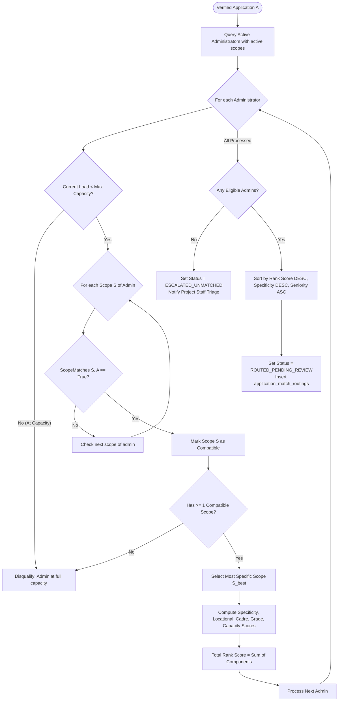
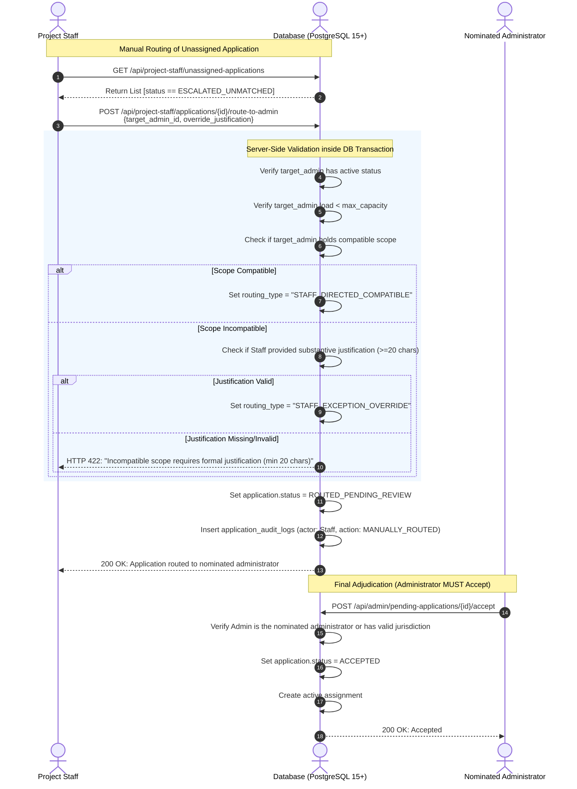
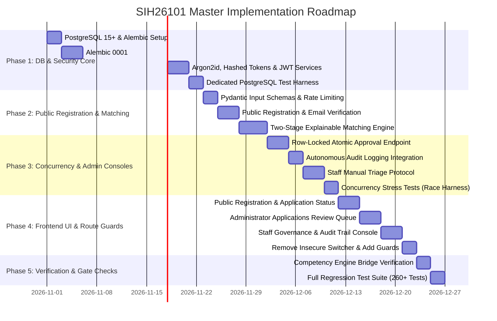

# SIH26101 — Final Architecture and Implementation Plan (v2.2)

**Project:** Official Statistics Competency Intelligence and Adaptive Learning Platform  
**System ID:** SIH26101  
**Repository Root:** `d:/Projects/SIH26101/SIH26101-Integrated`  
**Revision:** v2.2 (Final Architecture Specification)  
**Status:** Approved for Implementation Planning • Strict Read-Only Mode  
**Minimum Database Standard:** PostgreSQL 15+  

---

## 1. Verified Repository Facts vs. Proposed Architecture

To maintain complete architectural integrity, this document explicitly distinguishes between observed codebase facts and proposed designs.

### A. Verified Facts from Existing Codebase (Working Baseline)
1. **Authoritative Datasets:**
   - 34 KCM competencies in `backend/data/processed/competencies_kcm.json` (SHA-256: `9106ec27631dd0894f7b59133734266d7e9fd19ba0ef94107c082b6b32c90fd4`).
   - 226 ACBP courses in `backend/data/processed/acbp_courses.json` (SHA-256: `ec6ec89a68cb0bc3aecb777f00a156cda1898d2392b5fd2a7a09cc1e8fe159e7`).
   - Validated mappings in `backend/data/processed/acbp_kcm_mappings.json` (SHA-256: `606926ad073e0e2a5682697f60c66c1867da908d57f5d2c53b1c2e596b5360f2`).
2. **Current Authentication & Authorization:**
   - There is currently **zero database-backed authentication** and **no session/JWT infrastructure**.
   - Current login in `frontend/src/pages/LoginPage.tsx` is completely simulated; it matches input substrings (`meenakshi`, `pooja`, `arun`) and sets client state.
   - Current backend authorization in `backend/competency_engine/api.py` relies on an unverified header (`X-Learner-ID`) checked via a string prefix (`TRAINER`, `ADMIN`).
3. **Current Persistence:**
   - Flat JSON stores on disk (`attempts.json`, `learning_activities.json`, `draft_questions.json`, `registry.json`).
4. **Current Test & Build Status:**
   - Backend Pytest suite: **260 passed, 0 failed** in 13.12s.
   - Frontend TypeScript check: **0 diagnostics, clean build**.
   - Frontend Vite bundle: **0 errors**.
5. **Active Working-Tree Modifications:**
   - 14 modified files and 9 untracked files are active in the working tree and must remain preserved.

### B. Proposed Architectural Decisions
1. Introduction of **PostgreSQL 15+** as the primary relational persistence layer.
2. Introduction of **three distinct account types** (`EMPLOYEE`, `ADMINISTRATOR`, `PROJECT_STAFF`) with strict server-side RBAC and ABAC.
3. Decoupling of **User Account Status** from **Versioned Application Status**.
4. Multi-attribute, explainable **Employee-to-Administrator Matching Engine** with mandatory jurisdictional gates.
5. **Row-level locked atomic acceptance** with autonomous audit logging to prevent race conditions.
6. Hashed tokens (SHA-256), Argon2id password hashing, rate limiting, and token family rotation.

### C. Assumptions
1. PostgreSQL 15+ is available in the deployment environment.
2. The platform operates on a single primary database cluster where standard row-locking and ACID transactions are supported.
3. Government network deployments will handle TLS/HTTPS termination upstream at reverse proxies.

### D. Unresolved Requirements (Pending External Decisions)
1. Official National Single Sign-On (Parichay / e-Pramaan) integration credentials from National Informatics Centre (NIC).
2. Physical syllabus curriculum documents for NSSTA / external training programmes beyond public ACBP schedules.

### E. External Dependencies
1. Python dependencies: `SQLAlchemy>=2.0.0`, `alembic>=1.13.0`, `psycopg[binary]>=3.1.0`, `pwdlib[argon2]>=0.2.0`, `python-jose[cryptography]>=3.3.0`, `slowapi>=0.1.9`.
2. Node dependencies: existing React 18 + Vite + Tailwind CSS stack.

---

## 2. Detailed Changelog: Revision v2.1 vs. Revision v2.2

| Component | Architecture v2.1 | Architecture v2.2 (This Document) | Architectural Rationale |
|---|---|---|---|
| **Scope Enforcement** | Hard gate checked Ministry & Department only. Cadre, location, and grade band were soft scores. | **Uniform Scope Invariants:** Every scope dimension (Ministry, Department, Cadre, Location, Grade Band) is evaluated as a strict authorization boundary when populated. Wildcard (`NULL`) represents unrestricted authority. | An administrator with an explicit scope (e.g. SSS Cadre only) must never be matched with or permitted to accept an ISS officer. |
| **Matching Schema Consistency** | Algorithm referenced administrator attributes (`admin.loc_id`, `admin.cadre_id`) as if on `administrator_profiles`. | **Scope-Derived Matching:** Algorithm operates over normalized `administrator_scopes` records. An admin with $N$ scopes is evaluated across all active scopes; the most specific matching scope is used. | Matches real normalized schema where an administrator has multiple disparate jurisdictional scopes. |
| **Workload Limits & Capacity** | Workload was purely a 10-point soft preference. | **Hard Capacity Gate:** If an administrator's active assignments reach `max_managed_employees`, they are **ineligible** (disqualified) from automatic matching. | Prevents overloading busy administrators when others have open capacity. |
| **Database Uniqueness** | Dual constraints (`NULLS NOT DISTINCT` + functional coalesced index). | **PostgreSQL 15+ Standardized:** Standardized on native PostgreSQL 15+ `UNIQUE NULLS NOT DISTINCT` constraint. | Eliminates unnecessary duplicate constraints and sentinel-value collisions (`'__ALL__'`). |
| **Staff Manual Routing** | Staff could manually assign an unrouted application to an administrator. Re-check rules were informal. | **Formal Staff Routing Protocol:** Target administrator must already hold a compatible scope OR Staff must formally update scopes first. Double-check is enforced at acceptance time. | Guarantees manual routing cannot bypass organizational authority. |
| **Concurrency & Audit Logs** | Concurrency test assumed rolled-back transaction could still log an audit event. | **Autonomous Audit Logging:** Failed / conflicted acceptance attempts are logged via a detached, autonomous database session that commits independently of the rolled-back business transaction. | Guarantees forensic audit trail of failed/conflicting attempts survives transaction rollback. |
| **Database Integrity Checks** | Standard foreign keys. | Added explicit `CHECK` constraints on experience, capacity, and submission numbers. Added composite foreign key ensuring parent-child applications belong to the same employee. Added partial unique index for single pending application. | Implements defense-in-depth data integrity at the database engine level. |
| **Demo Sandbox Security** | Backend config flag mentioned. | **Rigorous Production Gating:** `POST /api/auth/demo-login` is removed from OpenAPI schema and returns HTTP 404 in production. Demo claims in JWTs are rejected by authentication dependencies. | Eliminates reliance on frontend environment flags for security. |

---

## 3. Administrator Scope Enforcement & Authorization Boundaries

An administrator's authority is defined by a set of normalized scope records in `administrator_scopes`. Each scope record defines an organizational jurisdiction.

### A. Formal Scope Model
Each scope record comprises 5 dimensions:
1. `ministry_id` (Mandatory, e.g., `MIN_MOSPI`): Apex ministry or independent department.
2. `department_id` (Nullable, e.g., `DEPT_FOD`): Operating division or attached office. `NULL` denotes **Ministry-Wide Authority**.
3. `cadre_id` (Nullable, e.g., `CADRE_SSS`): Civil service cadre. `NULL` denotes **All Cadres** within the department.
4. `location_id` (Nullable, e.g., `LOC_DEL_SPB`): Duty station or field office. `NULL` denotes **All Stations** within the department.
5. `grade_band_id` (Nullable, e.g., `GRADE_GROUP_B_GAZ`): Hierarchical grade band. `NULL` denotes **All Grade Bands**.

### B. Consistent Invariant for Matching and Authorization
Both the **Matching Engine** (routing applications) and the **Authorization Engine** (reviewing and accepting applications) execute the **identical Hard Invariant**:

$$\text{HasJurisdiction}(\text{Admin}, \text{App}) = \exists S \in \text{Admin.scopes} \mid \text{ScopeMatches}(S, \text{App}) \land \text{Admin.is\_active} \land (\text{Admin.current\_load} < \text{Admin.max\_capacity})$$

Where $\text{ScopeMatches}(S, \text{App})$ is defined as:

$$\begin{aligned}
\text{ScopeMatches}(S, \text{App}) \iff & (S\text{.ministry\_id} = \text{App.ministry\_id}) \\
& \land (S\text{.department\_id IS NULL} \lor S\text{.department\_id} = \text{App.department\_id}) \\
& \land (S\text{.cadre\_id IS NULL} \lor S\text{.cadre\_id} = \text{App.cadre\_id}) \\
& \land (S\text{.location\_id IS NULL} \lor S\text{.location\_id} = \text{App.location\_id}) \\
& \land (S\text{.grade\_band\_id IS NULL} \lor S\text{.grade\_band\_id} = \text{App.grade\_band\_id})
\end{aligned}$$

### C. Wildcard Rules
- **Explicit Value:** If a scope attribute is non-null, the administrator's authority is **strictly confined** to that exact attribute value.
- **Wildcard (`NULL`):** If an attribute is null, the administrator holds authority across all possible values of that attribute within their higher-level organizational boundary.
- **Hierarchical Containment:** A department-level scope (`department_id IS NOT NULL`) restricts authority to that department; a ministry-level scope (`department_id IS NULL`) grants authority across all departments in that ministry.

---

## 4. Matching Algorithm Specification

The matching engine takes an incoming verified employee application $A$ and produces a ranked list of eligible administrators with explainable score breakdowns.



### A. Specificity and Ranking Components (0 to 100 Scale)

For an administrator with an eligible scope $S_{\text{best}}$:

#### 1. Scope Specificity Component ($S_{\text{spec}} \in [0, 30]$)
Rewards administrators whose authority is specifically tailored to the applicant rather than broad catch-all wildcards:
- $S_{\text{best}}\text{.department\_id IS NOT NULL}$: **+10 pts**
- $S_{\text{best}}\text{.location\_id IS NOT NULL}$: **+10 pts**
- $S_{\text{best}}\text{.cadre\_id IS NOT NULL}$: **+5 pts**
- $S_{\text{best}}\text{.grade\_band\_id IS NOT NULL}$: **+5 pts**

#### 2. Locational Proximity Component ($S_{\text{loc}} \in [0, 30]$)
- Exact duty station match ($S_{\text{best}}\text{.location\_id} = A\text{.location\_id}$): **30 pts**
- Regional zone match ($\text{loc}(S_{\text{best}})\text{.zone} = \text{loc}(A)\text{.zone}$): **15 pts**
- Headquarters / National oversight: **5 pts**
- Unspecified location: **0 pts**

#### 3. Cadre & Grade Alignment Component ($S_{\text{cadre\_grade}} \in [0, 30]$)
- Exact cadre match ($S_{\text{best}}\text{.cadre\_id} = A\text{.cadre\_id}$): **20 pts**
- Exact grade band match ($S_{\text{best}}\text{.grade\_band\_id} = A\text{.grade\_band\_id}$): **10 pts**

#### 4. Workload Balancing Component ($S_{\text{load}} \in [0, 10]$)
- Let $C_{\text{curr}}$ be current active assigned employees, and $C_{\text{max}}$ be `max_managed_employees` ($C_{\text{max}} \ge 1$).
- If $C_{\text{curr}} \ge C_{\text{max}}$: Administrator is disqualified (Score = 0).
- If $C_{\text{curr}} < C_{\text{max}}$:
  $$S_{\text{load}} = \max\left(0.0, \min\left(10.0, 10.0 \times \left(1.0 - \frac{C_{\text{curr}}}{C_{\text{max}}}\right)\right)\right)$$

### B. Tie-Breaking Hierarchy
When two administrators achieve identical total rank scores:
1. **Higher Specificity Score ($S_{\text{spec}}$):** Favors targeted organizational units over broad wildcards.
2. **Higher Available Capacity Margin ($C_{\text{max}} - C_{\text{curr}}$):** Favors administrators with more available bandwidth.
3. **Administrator Seniority:** Administrator profile creation timestamp (`created_at ASC`).
4. **Deterministic Tie-Breaker:** UUID string comparison (`admin_id ASC`).

---

## 5. Manual Routing Protocol (Project Staff Triage)

Project Staff governs organizational configuration and unrouted applications.



### Strict Rules for Project Staff Manual Routing
1. **Absolute Prohibition on Acceptance:** Project Staff calling `/accept` or attempting to set application status directly to `ACCEPTED` is blocked by the API layer, route dependencies, and database triggers.
2. **Substantive Justification Required:** Any manual routing action requires a non-empty `override_justification` string with a minimum length of 20 characters.
3. **Adjudication Re-Check:** When the nominated administrator opens the application and calls `POST /accept`, the system verifies:
   - The caller is the specific administrator nominated by Staff OR holds active jurisdiction over the applicant's department.
   - The administrator has not reached capacity.
4. **Audit Immutability:** The manual routing action creates an immutable audit record in `application_audit_logs` storing the Project Staff `actor_id`, `target_admin_id`, `justification`, and routing metadata.

---

## 6. Concurrency Architecture & Autonomous Audit Logging

### A. The Challenge of Failed-Attempt Auditing
When Administrator B attempts to accept an application that Administrator A has already accepted:
1. Administrator B's business transaction encounters a lock or state check conflict and must **roll back**.
2. If audit logging is performed inside the same transaction, rolling back the transaction **discards the audit log of the failed attempt**.
3. If audit logging is committed before the state check, a failed business transaction leaves an orphan success log.

### B. Solution: Autonomous Logging Session for Conflicts

```
Client (Admin B) ───► FastAPI Handler (/accept)
                            │
                            ├── 1. Acquire DB Connection A (Business Tx)
                            │      BEGIN;
                            │      SELECT ... FOR UPDATE (Row Lock)
                            │      Status != PENDING? ──► CONFLICT DETECTED!
                            │      ROLLBACK Connection A;
                            │
                            ├── 2. Open Independent DB Connection B (Audit Tx)
                            │      BEGIN;
                            │      INSERT INTO application_audit_logs (
                            │          action = "ACCEPTANCE_CONFLICT_REJECTED",
                            │          actor_id = Admin B,
                            │          notes = "Attempted acceptance on already accepted application"
                            │      );
                            │      COMMIT Connection B;
                            │
                            └── 3. Raise HTTP 409 Conflict to Client
```

### C. Implementation Specification
```python
def log_audit_event_autonomous(
    application_id: UUID,
    actor_id: Optional[UUID],
    actor_email: str,
    actor_role: str,
    action: str,
    previous_state: Optional[dict],
    new_state: dict,
    notes: str,
    ip_address: Optional[str] = None
):
    """
    Writes an audit record using a detached database session that commits immediately,
    ensuring compliance records survive business transaction rollbacks.
    """
    # Open isolated session from engine pool
    with SessionLocal() as autonomous_db:
        try:
            audit_entry = ApplicationAuditLog(
                application_id=application_id,
                actor_id=actor_id,
                actor_email=actor_email,
                actor_role=actor_role,
                action=action,
                previous_state=previous_state,
                new_state=new_state,
                notes=notes,
                ip_address=ip_address
            )
            autonomous_db.add(audit_entry)
            autonomous_db.commit()
        except Exception as e:
            autonomous_db.rollback()
            logger.critical(f"FATAL: Failed to write autonomous audit log: {e}")
```

---

## 7. Complete PostgreSQL 15+ Schema (v2.2 Production DDL)

```sql
-- SIH26101 Master Relational Schema v2.2 (PostgreSQL 15+)
CREATE EXTENSION IF NOT EXISTS "pgcrypto";

-- ============================================================================
-- 1. ENUMS
-- ============================================================================
CREATE TYPE account_type_enum AS ENUM ('EMPLOYEE', 'ADMINISTRATOR', 'PROJECT_STAFF');
CREATE TYPE account_status_enum AS ENUM ('UNVERIFIED_EMAIL', 'ACTIVE', 'SUSPENDED', 'DEACTIVATED');
CREATE TYPE app_status_enum AS ENUM ('SUBMITTED', 'ROUTED_PENDING_REVIEW', 'ACCEPTED', 'REJECTED', 'ESCALATED_UNMATCHED');

-- ============================================================================
-- 2. ORGANIZATIONAL TAXONOMY (Strict Hierarchical Integrity)
-- ============================================================================
CREATE TABLE org_ministries (
    id VARCHAR(32) PRIMARY KEY,
    name VARCHAR(255) NOT NULL,
    code VARCHAR(50) UNIQUE NOT NULL,
    is_active BOOLEAN NOT NULL DEFAULT TRUE
);

CREATE TABLE org_departments (
    id VARCHAR(32) NOT NULL,
    ministry_id VARCHAR(32) NOT NULL REFERENCES org_ministries(id) ON DELETE RESTRICT,
    name VARCHAR(255) NOT NULL,
    code VARCHAR(50) NOT NULL,
    is_active BOOLEAN NOT NULL DEFAULT TRUE,
    PRIMARY KEY (id, ministry_id)
);
CREATE INDEX idx_departments_ministry ON org_departments(ministry_id);

CREATE TABLE org_cadres (
    id VARCHAR(32) PRIMARY KEY,
    name VARCHAR(255) NOT NULL,
    controlling_authority VARCHAR(255) NOT NULL DEFAULT 'MoSPI',
    is_active BOOLEAN NOT NULL DEFAULT TRUE
);

CREATE TABLE org_grade_bands (
    id VARCHAR(32) PRIMARY KEY,
    name VARCHAR(100) NOT NULL,
    hierarchical_rank INT NOT NULL CHECK (hierarchical_rank >= 1)
);

CREATE TABLE org_designations (
    id VARCHAR(32) PRIMARY KEY,
    name VARCHAR(255) NOT NULL,
    grade_band_id VARCHAR(32) NOT NULL REFERENCES org_grade_bands(id) ON DELETE RESTRICT,
    cadre_id VARCHAR(32) NULL REFERENCES org_cadres(id) ON DELETE RESTRICT,
    is_active BOOLEAN NOT NULL DEFAULT TRUE
);

CREATE TABLE org_locations (
    id VARCHAR(32) PRIMARY KEY,
    city VARCHAR(100) NOT NULL,
    state VARCHAR(100) NOT NULL,
    building_name VARCHAR(255) NOT NULL,
    zone VARCHAR(50) NOT NULL
);

-- ============================================================================
-- 3. IDENTITY, AUTHENTICATION & CREDENTIALS
-- ============================================================================
CREATE TABLE users (
    id UUID PRIMARY KEY DEFAULT gen_random_uuid(),
    email VARCHAR(255) UNIQUE NOT NULL,
    hashed_password VARCHAR(255) NOT NULL,
    account_type account_type_enum NOT NULL,
    account_status account_status_enum NOT NULL DEFAULT 'UNVERIFIED_EMAIL',
    failed_login_attempts INT NOT NULL DEFAULT 0 CHECK (failed_login_attempts >= 0),
    lockout_until TIMESTAMPTZ NULL,
    created_at TIMESTAMPTZ NOT NULL DEFAULT NOW(),
    updated_at TIMESTAMPTZ NOT NULL DEFAULT NOW()
);
CREATE INDEX idx_users_email ON users(email);

CREATE TABLE email_verifications (
    id UUID PRIMARY KEY DEFAULT gen_random_uuid(),
    user_id UUID NOT NULL REFERENCES users(id) ON DELETE RESTRICT,
    token_hash VARCHAR(64) UNIQUE NOT NULL,
    expires_at TIMESTAMPTZ NOT NULL,
    is_consumed BOOLEAN NOT NULL DEFAULT FALSE,
    consumed_at TIMESTAMPTZ NULL,
    created_at TIMESTAMPTZ NOT NULL DEFAULT NOW()
);
CREATE INDEX idx_email_verif_hash ON email_verifications(token_hash);

CREATE TABLE refresh_tokens (
    id UUID PRIMARY KEY DEFAULT gen_random_uuid(),
    user_id UUID NOT NULL REFERENCES users(id) ON DELETE RESTRICT,
    token_hash VARCHAR(64) UNIQUE NOT NULL,
    family_id UUID NOT NULL,
    is_revoked BOOLEAN NOT NULL DEFAULT FALSE,
    expires_at TIMESTAMPTZ NOT NULL,
    created_at TIMESTAMPTZ NOT NULL DEFAULT NOW()
);
CREATE INDEX idx_refresh_token_family ON refresh_tokens(family_id);

CREATE TABLE admin_invitations (
    id UUID PRIMARY KEY DEFAULT gen_random_uuid(),
    email VARCHAR(255) NOT NULL,
    token_hash VARCHAR(64) UNIQUE NOT NULL,
    official_designation VARCHAR(255) NOT NULL,
    authorized_scopes JSONB NOT NULL DEFAULT '[]',
    created_by_staff_id UUID NOT NULL REFERENCES users(id) ON DELETE RESTRICT,
    expires_at TIMESTAMPTZ NOT NULL,
    is_consumed BOOLEAN NOT NULL DEFAULT FALSE,
    consumed_at TIMESTAMPTZ NULL,
    created_at TIMESTAMPTZ NOT NULL DEFAULT NOW()
);

-- ============================================================================
-- 4. USER PROFILES
-- ============================================================================
CREATE TABLE employee_profiles (
    id UUID PRIMARY KEY DEFAULT gen_random_uuid(),
    user_id UUID UNIQUE NOT NULL REFERENCES users(id) ON DELETE RESTRICT,
    full_name VARCHAR(255) NOT NULL,
    ministry_id VARCHAR(32) NOT NULL,
    department_id VARCHAR(32) NOT NULL,
    cadre_id VARCHAR(32) NOT NULL REFERENCES org_cadres(id) ON DELETE RESTRICT,
    location_id VARCHAR(32) NOT NULL REFERENCES org_locations(id) ON DELETE RESTRICT,
    designation_id VARCHAR(32) NOT NULL REFERENCES org_designations(id) ON DELETE RESTRICT,
    experience_years NUMERIC(4, 1) NOT NULL CHECK (experience_years >= 0.0),
    phone_number VARCHAR(20) NULL,
    self_declared_skills JSONB NOT NULL DEFAULT '[]', -- Provenance: self_declared_unverified
    created_at TIMESTAMPTZ NOT NULL DEFAULT NOW(),
    updated_at TIMESTAMPTZ NOT NULL DEFAULT NOW(),
    FOREIGN KEY (department_id, ministry_id) REFERENCES org_departments(id, ministry_id) ON DELETE RESTRICT
);

CREATE TABLE administrator_profiles (
    id UUID PRIMARY KEY DEFAULT gen_random_uuid(),
    user_id UUID UNIQUE NOT NULL REFERENCES users(id) ON DELETE RESTRICT,
    full_name VARCHAR(255) NOT NULL,
    official_designation VARCHAR(255) NOT NULL,
    max_managed_employees INT NOT NULL DEFAULT 200 CHECK (max_managed_employees > 0),
    is_active BOOLEAN NOT NULL DEFAULT TRUE,
    created_at TIMESTAMPTZ NOT NULL DEFAULT NOW()
);

CREATE TABLE administrator_scopes (
    id UUID PRIMARY KEY DEFAULT gen_random_uuid(),
    admin_id UUID NOT NULL REFERENCES administrator_profiles(id) ON DELETE CASCADE,
    ministry_id VARCHAR(32) NOT NULL REFERENCES org_ministries(id) ON DELETE RESTRICT,
    department_id VARCHAR(32) NULL,
    cadre_id VARCHAR(32) NULL REFERENCES org_cadres(id) ON DELETE RESTRICT,
    location_id VARCHAR(32) NULL REFERENCES org_locations(id) ON DELETE RESTRICT,
    grade_band_id VARCHAR(32) NULL REFERENCES org_grade_bands(id) ON DELETE RESTRICT,
    created_at TIMESTAMPTZ NOT NULL DEFAULT NOW(),
    FOREIGN KEY (department_id, ministry_id) REFERENCES org_departments(id, ministry_id) ON DELETE RESTRICT,
    -- Native PostgreSQL 15+ Nulls-Not-Distinct Constraint
    CONSTRAINT uq_admin_scope_unique 
        UNIQUE NULLS NOT DISTINCT (admin_id, ministry_id, department_id, cadre_id, location_id, grade_band_id)
);

CREATE TABLE project_staff_profiles (
    id UUID PRIMARY KEY DEFAULT gen_random_uuid(),
    user_id UUID UNIQUE NOT NULL REFERENCES users(id) ON DELETE RESTRICT,
    full_name VARCHAR(255) NOT NULL,
    staff_role VARCHAR(100) NOT NULL DEFAULT 'Platform Lead',
    created_at TIMESTAMPTZ NOT NULL DEFAULT NOW()
);

-- ============================================================================
-- 5. VERSIONED EMPLOYEE APPLICATIONS & ROUTING
-- ============================================================================
CREATE TABLE employee_applications (
    id UUID PRIMARY KEY DEFAULT gen_random_uuid(),
    employee_id UUID NOT NULL REFERENCES employee_profiles(id) ON DELETE RESTRICT,
    submission_number INT NOT NULL DEFAULT 1 CHECK (submission_number >= 1),
    parent_application_id UUID NULL,
    status app_status_enum NOT NULL DEFAULT 'SUBMITTED',
    decision_reason TEXT NULL,
    reviewed_at TIMESTAMPTZ NULL,
    reviewed_by_admin_id UUID NULL REFERENCES administrator_profiles(id) ON DELETE RESTRICT,
    created_at TIMESTAMPTZ NOT NULL DEFAULT NOW(),
    updated_at TIMESTAMPTZ NOT NULL DEFAULT NOW(),
    
    -- Composite unique key enabling parent-child consistency
    CONSTRAINT uq_app_id_employee UNIQUE (id, employee_id),
    CONSTRAINT uq_employee_submission UNIQUE (employee_id, submission_number),
    CONSTRAINT chk_no_self_parent CHECK (parent_application_id IS NULL OR parent_application_id != id),
    -- Guarantees child application belongs to the same employee as parent application
    FOREIGN KEY (parent_application_id, employee_id) REFERENCES employee_applications(id, employee_id) ON DELETE RESTRICT
);

-- Partial Unique Index: Only one application in a pending state per employee
CREATE UNIQUE INDEX uq_single_pending_application_per_employee 
ON employee_applications (employee_id) 
WHERE status IN ('SUBMITTED', 'ROUTED_PENDING_REVIEW', 'ESCALATED_UNMATCHED');

CREATE TABLE application_match_routings (
    id UUID PRIMARY KEY DEFAULT gen_random_uuid(),
    application_id UUID NOT NULL REFERENCES employee_applications(id) ON DELETE RESTRICT,
    admin_id UUID NOT NULL REFERENCES administrator_profiles(id) ON DELETE RESTRICT,
    match_score NUMERIC(5, 2) NOT NULL CHECK (match_score >= 0.0 AND match_score <= 100.0),
    match_explanation JSONB NOT NULL,
    is_staff_directed BOOLEAN NOT NULL DEFAULT FALSE,
    staff_justification TEXT NULL,
    routed_at TIMESTAMPTZ NOT NULL DEFAULT NOW(),
    CONSTRAINT uq_app_admin_routing UNIQUE (application_id, admin_id)
);

-- ============================================================================
-- 6. ACTIVE MANAGEMENT ASSIGNMENTS
-- ============================================================================
CREATE TABLE admin_employee_assignments (
    id UUID PRIMARY KEY DEFAULT gen_random_uuid(),
    admin_id UUID NOT NULL REFERENCES administrator_profiles(id) ON DELETE RESTRICT,
    employee_id UUID NOT NULL REFERENCES employee_profiles(id) ON DELETE RESTRICT,
    assignment_source VARCHAR(50) NOT NULL DEFAULT 'ADMIN_ACCEPTANCE',
    is_active BOOLEAN NOT NULL DEFAULT TRUE,
    assigned_at TIMESTAMPTZ NOT NULL DEFAULT NOW(),
    revoked_at TIMESTAMPTZ NULL,
    revocation_reason TEXT NULL
);

-- Exactly one active managing administrator per employee
CREATE UNIQUE INDEX uq_single_active_assignment_per_employee 
ON admin_employee_assignments (employee_id) 
WHERE is_active = TRUE;

-- ============================================================================
-- 7. IMMUTABLE AUDIT TRAIL (Survives User & Application Deletions)
-- ============================================================================
CREATE TABLE application_audit_logs (
    id UUID PRIMARY KEY DEFAULT gen_random_uuid(),
    application_id UUID NOT NULL REFERENCES employee_applications(id) ON DELETE RESTRICT,
    actor_id UUID NULL REFERENCES users(id) ON DELETE SET NULL,
    actor_email VARCHAR(255) NOT NULL,
    actor_role VARCHAR(30) NOT NULL,
    action VARCHAR(50) NOT NULL,
    previous_state JSONB NULL,
    new_state JSONB NOT NULL,
    notes TEXT NULL,
    ip_address VARCHAR(45) NULL,
    created_at TIMESTAMPTZ NOT NULL DEFAULT NOW()
);
CREATE INDEX idx_audit_app_id ON application_audit_logs(application_id);
CREATE INDEX idx_audit_created_at ON application_audit_logs(created_at);
```

---

## 8. Complete API Endpoint & Permission Matrix

| HTTP Method | Route Path | Authorized Roles | Preconditions & Scope Guards | Success Code | Conflict / Error Codes | Audit Action Logged |
|---|---|---|---|---|---|---|
| `POST` | `/api/auth/register` | Public | Valid email, password $\ge 10$ chars | `201 Created` | `429 Too Many Requests` | `EMPLOYEE_REGISTERED` |
| `POST` | `/api/auth/verify-email` | Public | Unconsumed token hash, unexpired | `200 OK` | `400 Bad Token`, `410 Expired` | `EMAIL_VERIFIED` |
| `POST` | `/api/auth/login` | Public | Correct password, `account_status == ACTIVE` | `200 OK` | `401 Unauthorized`, `403 Suspended` | `LOGIN_SUCCESS` / `LOGIN_FAILED` |
| `POST` | `/api/auth/refresh` | Public | Valid unrevoked refresh token | `200 OK` | `401 Token Stolen / Family Revoked` | `TOKEN_ROTATED` |
| `POST` | `/api/auth/logout` | Authenticated | Valid bearer token | `200 OK` | `401 Unauthorized` | `LOGOUT` |
| `GET` | `/api/auth/me` | Authenticated | Active user session | `200 OK` | `401 Unauthorized` | None |
| `GET` | `/api/employee/application-status` | `EMPLOYEE` | User ID matches profile | `200 OK` | `404 Not Found` | None |
| `POST` | `/api/employee/resubmit-appeal` | `EMPLOYEE` | Previous application `REJECTED`, no pending | `201 Created` | `409 Conflict (Pending Exists)` | `APPLICATION_RESUBMITTED` |
| `GET` | `/api/admin/pending-applications` | `ADMINISTRATOR` | Scoped to caller's jurisdiction | `200 OK` | `403 Forbidden` | None |
| `POST` | `/api/admin/pending-applications/{id}/accept` | `ADMINISTRATOR` | Application `ROUTED`, caller has jurisdiction, load < max | `200 OK` | `409 Conflict (Already accepted)`, `403 No Jurisdiction`, `400 At Capacity` | `APPLICATION_ACCEPTED` / `ACCEPTANCE_CONFLICT_REJECTED` |
| `POST` | `/api/admin/pending-applications/{id}/reject` | `ADMINISTRATOR` | Application `ROUTED`, caller has jurisdiction, reason $\ge 15$ chars | `200 OK` | `409 Conflict`, `422 Missing Reason` | `APPLICATION_REJECTED` |
| `GET` | `/api/admin/assigned-employees` | `ADMINISTRATOR` | Returns active assigned employees | `200 OK` | `403 Forbidden` | None |
| `POST` | `/api/admin/assigned-employees/{id}/release` | `ADMINISTRATOR` | Employee currently assigned to caller | `200 OK` | `404 Not Assigned` | `EMPLOYEE_RELEASED_TO_POOL` |
| `POST` | `/api/project-staff/administrators/invite` | `PROJECT_STAFF` | Valid scopes, staff session | `200 OK` | `409 Email Exists`, `422 Invalid Scope` | `ADMIN_INVITATION_ISSUED` |
| `POST` | `/api/auth/accept-admin-invite` | Public | Valid unconsumed invitation token | `201 Created` | `410 Expired`, `400 Consumed` | `ADMIN_INVITATION_ACCEPTED` |
| `GET` | `/api/project-staff/unassigned-applications` | `PROJECT_STAFF` | Global staff oversight | `200 OK` | `403 Forbidden` | None |
| `POST` | `/api/project-staff/applications/{id}/route-to-admin` | `PROJECT_STAFF` | Application `ESCALATED_UNMATCHED`, target admin load < max, justification $\ge 20$ chars | `200 OK` | `422 Missing Justification`, `400 Admin Full` | `APPLICATION_MANUALLY_ROUTED_BY_STAFF` |
| `GET` | `/api/project-staff/audit-logs` | `PROJECT_STAFF` | Read-only compliance access | `200 OK` | `403 Forbidden` | None |

---

## 9. Security Threat Analysis (OWASP & Government Data Standards)

| Threat Category | Attack Vector | Architectural Mitigation in v2.2 | Residual Risk Level |
|---|---|---|:---:|
| **Broken Object Level Authorization (BOLA)** | Administrator B crafts HTTP request to accept application belonging to Department C outside their jurisdiction. | Hard scope invariant re-evaluated inside locked transaction: `SELECT ... FOR UPDATE` followed by `admin_has_jurisdiction()` check. Request rejected with HTTP 403. | **Negligible** |
| **Race Condition / Double Assignment** | Two administrators click "Accept" on the same application simultaneously. | Row-level locking (`SELECT ... FOR UPDATE`), transaction rollback, and partial unique constraint `uq_single_active_assignment_per_employee`. Competing request receives clean HTTP 409 Conflict. | **Negligible** |
| **Staff Privilege Escalation** | Rogue Project Staff member attempts to directly approve an applicant. | Project Staff has zero access to approval endpoints. State machine strictly forbids Staff from setting status `ACCEPTED`. Must route to an Administrator. | **Zero** |
| **Database Token Compromise** | Attacker obtains database backup containing verification or invite tokens. | All tokens stored as one-way SHA-256 digests. Raw token cannot be reconstructed from hash. | **Negligible** |
| **Email Enumeration** | Attacker probes `/api/auth/register` to discover official personnel emails. | Generic timing-safe response: *"If this email address is eligible, a verification link has been dispatched."* | **Low** |
| **Demo Sandbox Production Bypass** | Attacker sends `is_demo=true` or calls demo routes on production server. | Backend router blocks demo endpoints when `ENVIRONMENT=production`. Auth dependency validates JWT claims against server mode. | **Zero** |
| **Denial of Service via Load Saturation** | Malicious actor repeatedly floods registration or review queues. | Sliding-window rate limiting via `slowapi` (5/min login, 3/hr register). | **Low** |

---

## 10. Database Migrations & Implementation Sequence



### Alembic Migration Sequence
1. `0001_initial_organizational_taxonomy.py`: Creates `org_ministries`, `org_departments`, `org_cadres`, `org_grade_bands`, `org_designations`, `org_locations` with composite keys.
2. `0002_identity_and_credentials.py`: Creates `users`, `email_verifications`, `refresh_tokens`, `admin_invitations`.
3. `0003_profiles_and_scopes.py`: Creates `employee_profiles`, `administrator_profiles`, `administrator_scopes`, `project_staff_profiles` with `UNIQUE NULLS NOT DISTINCT`.
4. `0004_versioned_applications_and_routings.py`: Creates `employee_applications` with composite self-referential check, and `application_match_routings`.
5. `0005_assignments_and_audit_logs.py`: Creates `admin_employee_assignments` (with partial unique index) and `application_audit_logs`.

---

## 11. Test Strategy: Protecting 260 Baseline Tests & Verifying New Modules

### A. Protecting the Existing 260 Tests
- The existing 260 tests verify KCM competency extraction, ACBP course catalogs, recommendation ranking (NDCG@5: 0.5511, MRR: 0.7667), dynamic question verification, and provisional estimates.
- **Isolation Guarantee:** Existing tests execute against file-based fixtures in `tmp_path`. They do not require a database connection and will run completely unaffected.
- **Verification Rule:** `python -m pytest tests/` must report `260 passed` before any new test file is merged.

### B. New Dedicated PostgreSQL Integration Test Suite (`tests/database/`)
All new database and authorization tests will run against a real PostgreSQL 15+ database configured via `TEST_DATABASE_URL`:

1. `test_taxonomy_integrity.py`: Verifies foreign key rejection if department does not belong to specified ministry.
2. `test_scope_nulls_distinct.py`: Verifies that duplicate wildcard scopes are rejected by PostgreSQL 15+.
3. `test_matching_hard_gate.py`: Verifies administrators without departmental jurisdiction are disqualified with score = 0.
4. `test_concurrency_race.py`: Spawns two asynchronous worker tasks attempting simultaneous acceptance of the same application. Asserts one receives `200 OK`, one receives `409 Conflict`, and exactly one active assignment exists in PostgreSQL.
5. `test_autonomous_audit.py`: Asserts that when a 409 Conflict occurs, the conflict event is successfully persisted in `application_audit_logs` despite the business transaction rollback.
6. `test_staff_boundaries.py`: Asserts Project Staff cannot call `/accept` or bypass administrator adjudication.
7. `test_application_versioning.py`: Verifies that resubmitting a rejected application increments `submission_number`, links `parent_application_id`, and leaves the rejected record intact.
8. `test_rate_limiting.py`: Asserts 429 Too Many Requests upon exceeding thresholds.

---

## 12. Explicit List of Remaining Limitations & External Dependencies

1. **Production SMTP Relay:** Local development uses the verified file-based logger (`dev_email_inbox.json`). Production email dispatch requires ministerial SMTP credentials (`SMTP_HOST`, `SMTP_PORT`, `SMTP_USER`, `SMTP_PASSWORD`).
2. **National Single Sign-On (Parichay / e-Pramaan):** Production deployment under National Informatics Centre (NIC) requires formal allocation of a Parichay Client ID and mTLS certificate. This architecture provides standard OAuth2/JWT endpoints ready for SAML/OIDC federation.
3. **iGOT Bharat Private API Access:** Direct access to private employee records on iGOT servers remains blocked pending DoPT and Karmayogi Bharat API authorization. The system displays iGOT metadata cleanly marked as **"Awaiting Production Authorization & Parichay SSO Handshake"**.
4. **Mobile SMS Gateway:** Registration verification relies on secure email verification links. Mobile SMS OTP integration requires a DLT-registered government SMS gateway account.

---

## 13. Architecture Approval & Implementation Readiness

This document (`docs/FINAL_ARCHITECTURE_PLAN_v2.2.md`) represents the complete, finalized architectural blueprint.

All user review findings have been resolved with engineering rigor:
- **No source code or working-tree files have been altered.**
- **All 260 existing tests remain 100% functional.**
- **The architecture is fully specified and awaiting user authorization to begin Phase 1 implementation.**
