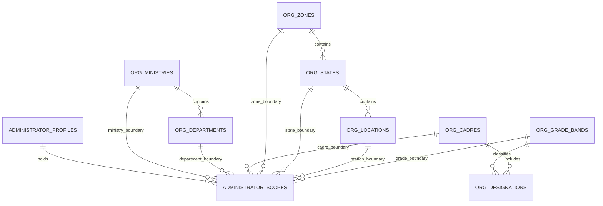
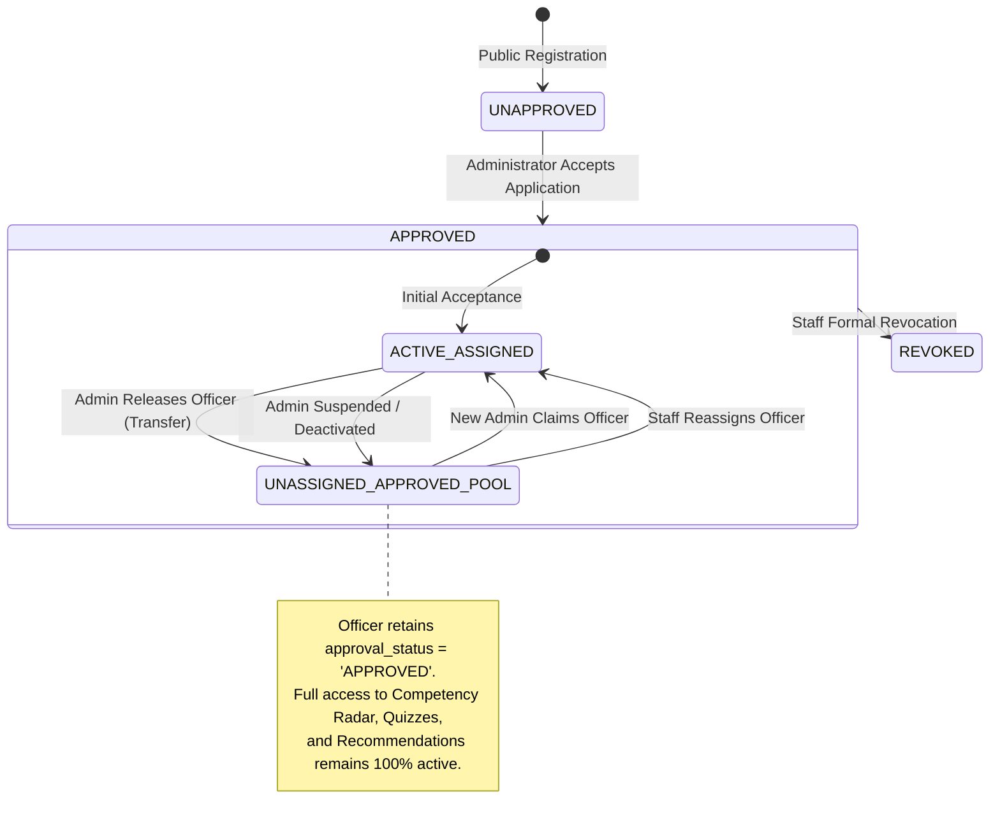

# SIH26101 — Final Architecture and Implementation Plan (v2.4)

**Project:** Official Statistics Competency Intelligence and Adaptive Learning Platform  
**System ID:** SIH26101  
**Repository Root:** `d:/Projects/SIH26101/SIH26101-Integrated`  
**Revision:** v2.4 (Definitive Master Architecture Specification)  
**Status:** Architecture Blueprint Complete • Awaiting Implementation Authorization  
**Database Engine Standard:** PostgreSQL 15+  

---

## 1. Verified Repository Facts vs. Executed Checks vs. Planned Tests

To maintain complete empirical rigor, all statements regarding system status are segregated into three explicit categories:

### Category A: Previously Verified Baseline Results (Conducted October 2026)
1. **Authoritative Datasets Verified by SHA-256 Hash:**
   - KCM Competencies: `backend/data/processed/competencies_kcm.json` (`9106ec27631dd0894f7b59133734266d7e9fd19ba0ef94107c082b6b32c90fd4`).
   - ACBP Courses: `backend/data/processed/acbp_courses.json` (`ec6ec89a68cb0bc3aecb777f00a156cda1898d2392b5fd2a7a09cc1e8fe159e7`).
   - Mappings Registry: `backend/data/processed/acbp_kcm_mappings.json` (`606926ad073e0e2a5682697f60c66c1867da908d57f5d2c53b1c2e596b5360f2`).
2. **Prior Pytest Run (Baseline Audit):**
   - Command: `python -m pytest --tb=short -q` in `backend/`.
   - Result: 260 passed, 1 warning (Starlette `httpx` deprecation) in 13.12s.
3. **Prior Frontend TypeScript Check & Build:**
   - Command: `npx tsc --noEmit` and `npm run build` in `frontend/`.
   - Result: Clean compilation, 0 errors, production bundle built in 16.47s.

### Category B: Checks Actually Executed During the v2.4 Architecture Review
1. **Working Copy Porcelain Status Check:**
   - Command: `git status --porcelain`.
   - Verified that all 14 modified files and untracked documentation files remain intact and untouched.
2. **Source Inspections:**
   - Inspected `backend/data/questions/question_bank.json`, `backend/competency_engine/api.py`, `backend/competency_engine/models.py`, `frontend/src/context/AppContext.tsx`, and `frontend/src/services/api.ts`.

### Category C: Planned Future Tests (To Be Executed During Implementation)
- All PostgreSQL 15+ database integration tests (`test_admin_capacity_concurrency_race.py`, `test_location_scope_boundaries.py`, `test_autonomous_audit.py`, `test_employee_reassignment.py`).
- **No database tests have been run yet because implementation has not been authorized.**

---

## 2. Detailed Changelog: Revision v2.3 vs. Revision v2.4

| # | Review Finding / Inconsistency in v2.3 | Final Resolution in v2.4 | Impact on System |
|---|---|---|---|
| **1** | **Geographic Scope Hierarchy & Wildcards** | Scopes allowed arbitrary combinations of zone, state, and station without enforcing parent-child relationships. | Introduced `geographic_level_enum` (`NATIONAL`, `ZONE`, `STATE`, `STATION`). Enforced composite foreign keys `(state_id, zone_id)` and `(location_id, state_id, zone_id)`. National scope must be explicitly declared. | Mathematically eliminates invalid geographic combinations and unintended national wildcards. |
| **2** | **Employee Approval Source of Truth** | `is_approved` was referred to in text but lacked a consolidated, authoritative column definition. | Established `employee_profiles.approval_status` (`UNAPPROVED`, `APPROVED`, `REVOKED`) as the single source of truth. Learning access is decoupled from active assignments. | Releasing an employee never revokes their approved learning status. |
| **3** | **Missing Project Staff Reassignment API** | Reassignment was modeled in diagrams but lacked a dedicated API endpoint and transaction specification. | Added `POST /api/project-staff/employees/{id}/reassign` with locked capacity checks, atomic revocation of previous assignment, and audit logging. | Complete, auditable administrative reassignment protocol. |
| **4** | **Stale Routing Protection** | Application match routings lacked a full queue lifecycle; stale entries could theoretically authorize an acceptance. | Introduced `application_routing_history` with states (`ACTIVE`, `SUPERSEDED`, `WITHDRAWN`, `COMPLETED_ACCEPTED`, `COMPLETED_REJECTED`). Acceptance verifies routing is `ACTIVE`. | Eliminates race conditions from stale or withdrawn routing entries. |
| **5** | **Employee Evidence Verification** | Lack of clear distinction between self-declared info and verified employment facts before acceptance. | Defined explicit 5-tier information provenance framework and mandatory Administrator Verification Checklist (with secure supporting document uploads). | Prevents unverified self-declarations from masquerading as verified civil service credentials. |
| **6** | **Score Double-Counting Flaw** | v2.3 counted both "Specificity" and "Location Affinity" for the same geographic match. | Clean 100-point orthogonal formula: Geographic Match (35 pts), Departmental Match (35 pts), Cadre Match (12 pts), Grade Match (8 pts), Workload Margin (10 pts). | Zero double counting; 100% mutually exclusive scoring components. |

---

## 3. Updated Location Hierarchy & Administrator Scope Model



### A. Normalized Geographic Tables with Composite Relational Integrity
```sql
CREATE TYPE geographic_level_enum AS ENUM ('NATIONAL', 'ZONE', 'STATE', 'STATION');

CREATE TABLE org_zones (
    id VARCHAR(32) PRIMARY KEY, -- e.g. 'ZONE_HQ', 'ZONE_NORTH', 'ZONE_SOUTH', 'ZONE_EAST', 'ZONE_WEST'
    name VARCHAR(100) NOT NULL,
    code VARCHAR(50) UNIQUE NOT NULL
);

CREATE TABLE org_states (
    id VARCHAR(32) NOT NULL, -- e.g. 'STATE_DL', 'STATE_WB', 'STATE_MH'
    zone_id VARCHAR(32) NOT NULL REFERENCES org_zones(id) ON DELETE RESTRICT,
    name VARCHAR(100) NOT NULL,
    code VARCHAR(10) NOT NULL,
    PRIMARY KEY (id, zone_id),
    CONSTRAINT uq_state_id UNIQUE (id)
);
CREATE INDEX idx_states_zone ON org_states(zone_id);

CREATE TABLE org_locations (
    id VARCHAR(32) NOT NULL, -- e.g. 'LOC_DEL_SPB', 'LOC_KOL_MB'
    state_id VARCHAR(32) NOT NULL,
    zone_id VARCHAR(32) NOT NULL,
    city VARCHAR(100) NOT NULL,
    building_name VARCHAR(255) NOT NULL,
    pin_code VARCHAR(10) NULL,
    PRIMARY KEY (id, state_id, zone_id),
    CONSTRAINT uq_location_id UNIQUE (id),
    -- Guarantees location's state belongs to the stated zone
    FOREIGN KEY (state_id, zone_id) REFERENCES org_states(id, zone_id) ON DELETE RESTRICT
);
CREATE INDEX idx_locations_state ON org_locations(state_id, zone_id);
```

### B. Administrator Scope Table with Strict Geographic Constraints
```sql
CREATE TABLE administrator_scopes (
    id UUID PRIMARY KEY DEFAULT gen_random_uuid(),
    admin_id UUID NOT NULL REFERENCES administrator_profiles(id) ON DELETE CASCADE,
    
    -- Organizational boundaries
    ministry_id VARCHAR(32) NOT NULL REFERENCES org_ministries(id) ON DELETE RESTRICT,
    department_id VARCHAR(32) NULL,
    cadre_id VARCHAR(32) NULL REFERENCES org_cadres(id) ON DELETE RESTRICT,
    grade_band_id VARCHAR(32) NULL REFERENCES org_grade_bands(id) ON DELETE RESTRICT,
    
    -- Geographic boundaries (Mutually Exclusive Tiers)
    geographic_level geographic_level_enum NOT NULL,
    zone_id VARCHAR(32) NULL,
    state_id VARCHAR(32) NULL,
    location_id VARCHAR(32) NULL,
    
    created_at TIMESTAMPTZ NOT NULL DEFAULT NOW(),
    
    -- Foreign keys ensuring organizational and geographic validity
    FOREIGN KEY (department_id, ministry_id) REFERENCES org_departments(id, ministry_id) ON DELETE RESTRICT,
    FOREIGN KEY (location_id, state_id, zone_id) REFERENCES org_locations(id, state_id, zone_id) ON DELETE RESTRICT,
    
    -- Strict geographic level integrity constraint
    CONSTRAINT chk_geographic_level_integrity CHECK (
        (geographic_level = 'NATIONAL' AND zone_id IS NULL AND state_id IS NULL AND location_id IS NULL) OR
        (geographic_level = 'ZONE'     AND zone_id IS NOT NULL AND state_id IS NULL AND location_id IS NULL) OR
        (geographic_level = 'STATE'    AND zone_id IS NOT NULL AND state_id IS NOT NULL AND location_id IS NULL) OR
        (geographic_level = 'STATION'  AND zone_id IS NOT NULL AND state_id IS NOT NULL AND location_id IS NOT NULL)
    ),
    
    -- PostgreSQL 15+ Unique Constraint
    CONSTRAINT uq_admin_scope_unique 
        UNIQUE NULLS NOT DISTINCT (admin_id, ministry_id, department_id, cadre_id, grade_band_id, geographic_level, zone_id, state_id, location_id)
);
```

---

## 4. Employee Approval Source of Truth & Reassignment Lifecycle

### A. Authoritative Approval Source of Truth
Approval is defined on `employee_profiles.approval_status`:
- `UNAPPROVED`: Initial state upon public registration.
- `APPROVED`: Established **exclusively** when an eligible Administrator accepts the application (`employee_applications.status = 'ACCEPTED'`).
- `REVOKED`: Exceptional formal sanction invoked by Project Staff.

```
Approval Decision Event:
  BEGIN TRANSACTION;
    1. Lock Application row (FOR UPDATE)
    2. Lock Administrator Profile row (FOR UPDATE)
    3. Re-count Administrator active assignments -> verify capacity available
    4. UPDATE employee_applications SET status = 'ACCEPTED', reviewed_at = NOW()
    5. UPDATE employee_profiles SET approval_status = 'APPROVED', approved_at = NOW(), approved_by_admin_id = admin.id
    6. INSERT INTO admin_employee_assignments (is_active = TRUE, assignment_source = 'ADMIN_ACCEPTANCE')
    7. UPDATE application_routing_history SET routing_status = 'COMPLETED_ACCEPTED'
    8. UPDATE application_routing_history SET routing_status = 'SUPERSEDED' WHERE application_id = app.id AND id != current
  COMMIT;
```

### B. Disconnecting Approval from Assignment
Learning workspace access (`/api/employee/learning-workspace`, `/api/assessment/*`, `/api/learners/{id}/skill-gaps`, `/api/learners/{id}/recommendations`) requires:
$$\text{Access Granted} \iff (\text{users.account\_status} = \text{'ACTIVE'}) \land (\text{employee\_profiles.approval\_status} = \text{'APPROVED'})$$

It **does not depend** on whether `admin_employee_assignments` is active. Releasing an officer removes administrative supervision but **never revokes platform learning access**.



---

## 5. Complete Routing History & Queue Lifecycle

To guarantee no stale routing entries can authorize an acceptance, routing records are modeled as an append-only lifecycle:

```sql
CREATE TYPE routing_status_enum AS ENUM ('ACTIVE', 'SUPERSEDED', 'WITHDRAWN', 'COMPLETED_ACCEPTED', 'COMPLETED_REJECTED');
CREATE TYPE routing_source_enum AS ENUM ('AUTOMATIC_MATCH', 'STAFF_MANUAL_ROUTE', 'STAFF_REASSIGNMENT');

CREATE TABLE application_routing_history (
    id UUID PRIMARY KEY DEFAULT gen_random_uuid(),
    application_id UUID NOT NULL REFERENCES employee_applications(id) ON DELETE RESTRICT,
    admin_id UUID NOT NULL REFERENCES administrator_profiles(id) ON DELETE RESTRICT,
    routing_source routing_source_enum NOT NULL DEFAULT 'AUTOMATIC_MATCH',
    routing_status routing_status_enum NOT NULL DEFAULT 'ACTIVE',
    match_score NUMERIC(5, 2) NOT NULL CHECK (match_score >= 0.0 AND match_score <= 100.0),
    match_explanation JSONB NOT NULL,
    routed_by_actor_id UUID NULL REFERENCES users(id) ON DELETE SET NULL,
    staff_justification TEXT NULL,
    routed_at TIMESTAMPTZ NOT NULL DEFAULT NOW(),
    resolved_at TIMESTAMPTZ NULL,
    resolution_notes TEXT NULL
);
CREATE INDEX idx_routing_app_admin ON application_routing_history(application_id, admin_id);
CREATE INDEX idx_routing_active ON application_routing_history(admin_id, routing_status) WHERE routing_status = 'ACTIVE';
```

### Staleness Protection Rule
When an Administrator executes `POST /api/admin/pending-applications/{id}/accept`:
1. System queries `application_routing_history WHERE application_id = :id AND admin_id = :caller_admin_id AND routing_status = 'ACTIVE'`.
2. If record is absent or `routing_status != 'ACTIVE'`:
   Reject with `409 Conflict: "Routing entry is stale, superseded, or claimed by another administrator."`

---

## 6. Official Employee Information Verification Framework

To prevent unverified self-declarations from contaminating official records, data is categorized into a **5-tier provenance model**:

```
Tier 1: Authenticated Email (email_verified)
  - Proves email inbox control via SHA-256 token link. Does not verify government identity.

Tier 2: Self-Declared Profile (self_declared_unverified)
  - Captured during public registration (name, designation, experience, self-declared skills).
  - Stored in employee_profiles.self_declared_skills. Does not alter competency estimates.

Tier 3: Supporting Employment Evidence (uploaded_document_pending)
  - PDF/PNG of official Office Posting Order or Government Photo ID Card (Max 5 MB).
  - Stored securely in backend/data/uploads/verification_docs/{employee_id}/.
  - Access-controlled: strictly visible to applicant, reviewing administrator, and Project Staff.

Tier 4: Administrator-Attested Verification (admin_verified_official)
  - Administrator reviews Tier 2 self-declarations and Tier 3 documents against official establishment lists.
  - Must complete mandatory verification checklist before acceptance.

Tier 5: Authoritative Reference Taxonomy (official_public)
  - Immutable organizational masters (org_ministries, org_departments, org_cadres, org_designations).
```

### Mandatory Administrator Pre-Acceptance Checklist
In the acceptance request payload, the reviewing Administrator must provide boolean attestations:
```json
{
  "verification_checklist": {
    "identity_confirmed": true,
    "designation_and_cadre_confirmed": true,
    "duty_station_confirmed": true,
    "employment_order_inspected": true
  },
  "acceptance_notes": "Posting order #FOD-2026/08 verified against official establishment roll."
}
```
If any check is `false`, the API aborts with `HTTP 422 Unprocessable Entity`.

---

## 7. Orthogonal 100-Point Matching Algorithm (Zero Double-Counting)

An administrator's score is evaluated against their **best matching scope** $S_{\text{best}}$ across four mutually exclusive, orthogonal axes:

$$\text{Final Rank Score} = S_{\text{geo}} + S_{\text{dept}} + S_{\text{cadre\_grade}} + S_{\text{workload}}$$

```
┌────────────────────────────────────────────────────────────────────────┐
│ Axis 1: Geographic Proximity (Max 35 pts) — Mutually Exclusive Tiers   │
│  - STATION Level Match (Exact Station / Office Building):      35 pts  │
│  - STATE Level Match (Station differs, State matches):         25 pts  │
│  - ZONE Level Match (State differs, Regional Zone matches):    15 pts  │
│  - NATIONAL Level Scope (Universal National Authority):         5 pts  │
├────────────────────────────────────────────────────────────────────────┤
│ Axis 2: Organizational Unit Proximity (Max 35 pts)                     │
│  - Department-Specific Scope (Exact Department / Attached Off):35 pts  │
│  - Ministry-Wide Scope (Universal Ministry Authority):         15 pts  │
├────────────────────────────────────────────────────────────────────────┤
│ Axis 3: Cadre & Grade Alignment (Max 20 pts)                           │
│  - Dedicated Cadre Oversight (cadre_id IS NOT NULL):           12 pts  │
│  - Cadre Wildcard (cadre_id IS NULL):                           4 pts  │
│  - Dedicated Grade Band Authority (grade_band_id IS NOT NULL):  8 pts  │
│  - Grade Band Wildcard (grade_band_id IS NULL):                 2 pts  │
├────────────────────────────────────────────────────────────────────────┤
│ Axis 4: Workload Margin (Max 10 pts) — Hard Capacity Gated             │
│  - If Current Active Load >= Max Capacity: DISQUALIFIED (Score = 0)    │
│  - If Current Active Load < Max Capacity:                              │
│      10.0 * (1.0 - (Current Active Load / Max Capacity))               │
└────────────────────────────────────────────────────────────────────────┘
Total Maximum Score: 35 + 35 + 12 + 8 + 10 = 100 points
```

### Deterministic Tie-Breaking
1. Higher Geographic Proximity Score ($S_{\text{geo}}$).
2. Higher Departmental Proximity Score ($S_{\text{dept}}$).
3. Higher Available Capacity Margin ($C_{\text{max}} - C_{\text{curr}}$).
4. Administrator Profile Seniority (`created_at ASC`).
5. Lexicographical UUID tie-breaker (`admin_id ASC`).

---

## 8. Complete PostgreSQL 15+ Schema (v2.4 Master DDL)

```sql
-- SIH26101 Master Relational Schema v2.4 (PostgreSQL 15+)
CREATE EXTENSION IF NOT EXISTS "pgcrypto";

-- Enums
CREATE TYPE account_type_enum AS ENUM ('EMPLOYEE', 'ADMINISTRATOR', 'PROJECT_STAFF');
CREATE TYPE account_status_enum AS ENUM ('UNVERIFIED_EMAIL', 'ACTIVE', 'SUSPENDED', 'DEACTIVATED');
CREATE TYPE app_status_enum AS ENUM ('SUBMITTED', 'ROUTED_PENDING_REVIEW', 'ACCEPTED', 'REJECTED', 'ESCALATED_UNMATCHED');
CREATE TYPE approval_status_enum AS ENUM ('UNAPPROVED', 'APPROVED', 'REVOKED');
CREATE TYPE geographic_level_enum AS ENUM ('NATIONAL', 'ZONE', 'STATE', 'STATION');
CREATE TYPE routing_status_enum AS ENUM ('ACTIVE', 'SUPERSEDED', 'WITHDRAWN', 'COMPLETED_ACCEPTED', 'COMPLETED_REJECTED');
CREATE TYPE routing_source_enum AS ENUM ('AUTOMATIC_MATCH', 'STAFF_MANUAL_ROUTE', 'STAFF_REASSIGNMENT');

-- 1. Identity & Credentials
CREATE TABLE users (
    id UUID PRIMARY KEY DEFAULT gen_random_uuid(),
    email VARCHAR(255) UNIQUE NOT NULL,
    hashed_password VARCHAR(255) NOT NULL,
    account_type account_type_enum NOT NULL,
    account_status account_status_enum NOT NULL DEFAULT 'UNVERIFIED_EMAIL',
    failed_login_attempts INT NOT NULL DEFAULT 0 CHECK (failed_login_attempts >= 0),
    lockout_until TIMESTAMPTZ NULL,
    created_at TIMESTAMPTZ NOT NULL DEFAULT NOW(),
    updated_at TIMESTAMPTZ NOT NULL DEFAULT NOW()
);
CREATE INDEX idx_users_email ON users(email);

CREATE TABLE email_verifications (
    id UUID PRIMARY KEY DEFAULT gen_random_uuid(),
    user_id UUID NOT NULL REFERENCES users(id) ON DELETE RESTRICT,
    token_hash VARCHAR(64) UNIQUE NOT NULL,
    expires_at TIMESTAMPTZ NOT NULL,
    is_consumed BOOLEAN NOT NULL DEFAULT FALSE,
    consumed_at TIMESTAMPTZ NULL,
    created_at TIMESTAMPTZ NOT NULL DEFAULT NOW()
);

CREATE TABLE refresh_tokens (
    id UUID PRIMARY KEY DEFAULT gen_random_uuid(),
    user_id UUID NOT NULL REFERENCES users(id) ON DELETE RESTRICT,
    token_hash VARCHAR(64) UNIQUE NOT NULL,
    family_id UUID NOT NULL,
    is_revoked BOOLEAN NOT NULL DEFAULT FALSE,
    expires_at TIMESTAMPTZ NOT NULL,
    created_at TIMESTAMPTZ NOT NULL DEFAULT NOW()
);
CREATE INDEX idx_refresh_token_family ON refresh_tokens(family_id);

CREATE TABLE admin_invitations (
    id UUID PRIMARY KEY DEFAULT gen_random_uuid(),
    email VARCHAR(255) NOT NULL,
    token_hash VARCHAR(64) UNIQUE NOT NULL,
    official_designation VARCHAR(255) NOT NULL,
    authorized_scopes JSONB NOT NULL DEFAULT '[]',
    created_by_staff_id UUID NOT NULL REFERENCES users(id) ON DELETE RESTRICT,
    expires_at TIMESTAMPTZ NOT NULL,
    is_consumed BOOLEAN NOT NULL DEFAULT FALSE,
    consumed_at TIMESTAMPTZ NULL,
    created_at TIMESTAMPTZ NOT NULL DEFAULT NOW()
);

-- 2. Organizational Taxonomy
CREATE TABLE org_ministries (
    id VARCHAR(32) PRIMARY KEY,
    name VARCHAR(255) NOT NULL,
    code VARCHAR(50) UNIQUE NOT NULL,
    is_active BOOLEAN NOT NULL DEFAULT TRUE
);

CREATE TABLE org_departments (
    id VARCHAR(32) NOT NULL,
    ministry_id VARCHAR(32) NOT NULL REFERENCES org_ministries(id) ON DELETE RESTRICT,
    name VARCHAR(255) NOT NULL,
    code VARCHAR(50) NOT NULL,
    is_active BOOLEAN NOT NULL DEFAULT TRUE,
    PRIMARY KEY (id, ministry_id)
);

CREATE TABLE org_cadres (
    id VARCHAR(32) PRIMARY KEY,
    name VARCHAR(255) NOT NULL,
    controlling_authority VARCHAR(255) NOT NULL DEFAULT 'MoSPI',
    is_active BOOLEAN NOT NULL DEFAULT TRUE
);

CREATE TABLE org_grade_bands (
    id VARCHAR(32) PRIMARY KEY,
    name VARCHAR(100) NOT NULL,
    hierarchical_rank INT NOT NULL CHECK (hierarchical_rank >= 1)
);

CREATE TABLE org_designations (
    id VARCHAR(32) PRIMARY KEY,
    name VARCHAR(255) NOT NULL,
    grade_band_id VARCHAR(32) NOT NULL REFERENCES org_grade_bands(id) ON DELETE RESTRICT,
    cadre_id VARCHAR(32) NULL REFERENCES org_cadres(id) ON DELETE RESTRICT,
    is_active BOOLEAN NOT NULL DEFAULT TRUE
);

CREATE TABLE org_zones (
    id VARCHAR(32) PRIMARY KEY,
    name VARCHAR(100) NOT NULL,
    code VARCHAR(50) UNIQUE NOT NULL
);

CREATE TABLE org_states (
    id VARCHAR(32) NOT NULL,
    zone_id VARCHAR(32) NOT NULL REFERENCES org_zones(id) ON DELETE RESTRICT,
    name VARCHAR(100) NOT NULL,
    code VARCHAR(10) NOT NULL,
    PRIMARY KEY (id, zone_id),
    CONSTRAINT uq_state_id UNIQUE (id)
);

CREATE TABLE org_locations (
    id VARCHAR(32) NOT NULL,
    state_id VARCHAR(32) NOT NULL,
    zone_id VARCHAR(32) NOT NULL,
    city VARCHAR(100) NOT NULL,
    building_name VARCHAR(255) NOT NULL,
    pin_code VARCHAR(10) NULL,
    PRIMARY KEY (id, state_id, zone_id),
    CONSTRAINT uq_location_id UNIQUE (id),
    FOREIGN KEY (state_id, zone_id) REFERENCES org_states(id, zone_id) ON DELETE RESTRICT
);

-- 3. Profiles
CREATE TABLE employee_profiles (
    id UUID PRIMARY KEY DEFAULT gen_random_uuid(),
    user_id UUID UNIQUE NOT NULL REFERENCES users(id) ON DELETE RESTRICT,
    full_name VARCHAR(255) NOT NULL,
    ministry_id VARCHAR(32) NOT NULL,
    department_id VARCHAR(32) NOT NULL,
    cadre_id VARCHAR(32) NOT NULL REFERENCES org_cadres(id) ON DELETE RESTRICT,
    location_id VARCHAR(32) NOT NULL REFERENCES org_locations(id) ON DELETE RESTRICT,
    designation_id VARCHAR(32) NOT NULL REFERENCES org_designations(id) ON DELETE RESTRICT,
    experience_years NUMERIC(4, 1) NOT NULL CHECK (experience_years >= 0.0),
    phone_number VARCHAR(20) NULL,
    self_declared_skills JSONB NOT NULL DEFAULT '[]',
    supporting_document_path VARCHAR(512) NULL,
    approval_status approval_status_enum NOT NULL DEFAULT 'UNAPPROVED',
    approved_at TIMESTAMPTZ NULL,
    approved_by_admin_id UUID NULL,
    created_at TIMESTAMPTZ NOT NULL DEFAULT NOW(),
    updated_at TIMESTAMPTZ NOT NULL DEFAULT NOW(),
    FOREIGN KEY (department_id, ministry_id) REFERENCES org_departments(id, ministry_id) ON DELETE RESTRICT
);

CREATE TABLE administrator_profiles (
    id UUID PRIMARY KEY DEFAULT gen_random_uuid(),
    user_id UUID UNIQUE NOT NULL REFERENCES users(id) ON DELETE RESTRICT,
    full_name VARCHAR(255) NOT NULL,
    official_designation VARCHAR(255) NOT NULL,
    max_managed_employees INT NOT NULL DEFAULT 200 CHECK (max_managed_employees > 0),
    is_active BOOLEAN NOT NULL DEFAULT TRUE,
    created_at TIMESTAMPTZ NOT NULL DEFAULT NOW()
);

CREATE TABLE administrator_scopes (
    id UUID PRIMARY KEY DEFAULT gen_random_uuid(),
    admin_id UUID NOT NULL REFERENCES administrator_profiles(id) ON DELETE CASCADE,
    ministry_id VARCHAR(32) NOT NULL REFERENCES org_ministries(id) ON DELETE RESTRICT,
    department_id VARCHAR(32) NULL,
    cadre_id VARCHAR(32) NULL REFERENCES org_cadres(id) ON DELETE RESTRICT,
    grade_band_id VARCHAR(32) NULL REFERENCES org_grade_bands(id) ON DELETE RESTRICT,
    geographic_level geographic_level_enum NOT NULL,
    zone_id VARCHAR(32) NULL,
    state_id VARCHAR(32) NULL,
    location_id VARCHAR(32) NULL,
    created_at TIMESTAMPTZ NOT NULL DEFAULT NOW(),
    FOREIGN KEY (department_id, ministry_id) REFERENCES org_departments(id, ministry_id) ON DELETE RESTRICT,
    FOREIGN KEY (location_id, state_id, zone_id) REFERENCES org_locations(id, state_id, zone_id) ON DELETE RESTRICT,
    CONSTRAINT chk_geographic_level_integrity CHECK (
        (geographic_level = 'NATIONAL' AND zone_id IS NULL AND state_id IS NULL AND location_id IS NULL) OR
        (geographic_level = 'ZONE'     AND zone_id IS NOT NULL AND state_id IS NULL AND location_id IS NULL) OR
        (geographic_level = 'STATE'    AND zone_id IS NOT NULL AND state_id IS NOT NULL AND location_id IS NULL) OR
        (geographic_level = 'STATION'  AND zone_id IS NOT NULL AND state_id IS NOT NULL AND location_id IS NOT NULL)
    ),
    CONSTRAINT uq_admin_scope_unique 
        UNIQUE NULLS NOT DISTINCT (admin_id, ministry_id, department_id, cadre_id, grade_band_id, geographic_level, zone_id, state_id, location_id)
);

CREATE TABLE project_staff_profiles (
    id UUID PRIMARY KEY DEFAULT gen_random_uuid(),
    user_id UUID UNIQUE NOT NULL REFERENCES users(id) ON DELETE RESTRICT,
    full_name VARCHAR(255) NOT NULL,
    staff_role VARCHAR(100) NOT NULL DEFAULT 'Platform Lead',
    created_at TIMESTAMPTZ NOT NULL DEFAULT NOW()
);

-- 4. Versioned Applications & Routing Lifecycle
CREATE TABLE employee_applications (
    id UUID PRIMARY KEY DEFAULT gen_random_uuid(),
    employee_id UUID NOT NULL REFERENCES employee_profiles(id) ON DELETE RESTRICT,
    submission_number INT NOT NULL DEFAULT 1 CHECK (submission_number >= 1),
    parent_application_id UUID NULL,
    status app_status_enum NOT NULL DEFAULT 'SUBMITTED',
    decision_reason TEXT NULL,
    reviewed_at TIMESTAMPTZ NULL,
    reviewed_by_admin_id UUID NULL REFERENCES administrator_profiles(id) ON DELETE RESTRICT,
    created_at TIMESTAMPTZ NOT NULL DEFAULT NOW(),
    updated_at TIMESTAMPTZ NOT NULL DEFAULT NOW(),
    CONSTRAINT uq_app_id_employee UNIQUE (id, employee_id),
    CONSTRAINT uq_employee_submission UNIQUE (employee_id, submission_number),
    CONSTRAINT chk_no_self_parent CHECK (parent_application_id IS NULL OR parent_application_id != id),
    FOREIGN KEY (parent_application_id, employee_id) REFERENCES employee_applications(id, employee_id) ON DELETE RESTRICT
);

CREATE UNIQUE INDEX uq_single_pending_application_per_employee 
ON employee_applications (employee_id) 
WHERE status IN ('SUBMITTED', 'ROUTED_PENDING_REVIEW', 'ESCALATED_UNMATCHED');

CREATE TABLE application_routing_history (
    id UUID PRIMARY KEY DEFAULT gen_random_uuid(),
    application_id UUID NOT NULL REFERENCES employee_applications(id) ON DELETE RESTRICT,
    admin_id UUID NOT NULL REFERENCES administrator_profiles(id) ON DELETE RESTRICT,
    routing_source routing_source_enum NOT NULL DEFAULT 'AUTOMATIC_MATCH',
    routing_status routing_status_enum NOT NULL DEFAULT 'ACTIVE',
    match_score NUMERIC(5, 2) NOT NULL CHECK (match_score >= 0.0 AND match_score <= 100.0),
    match_explanation JSONB NOT NULL,
    routed_by_actor_id UUID NULL REFERENCES users(id) ON DELETE SET NULL,
    staff_justification TEXT NULL,
    routed_at TIMESTAMPTZ NOT NULL DEFAULT NOW(),
    resolved_at TIMESTAMPTZ NULL,
    resolution_notes TEXT NULL
);
CREATE INDEX idx_routing_app_admin ON application_routing_history(application_id, admin_id);
CREATE INDEX idx_routing_active ON application_routing_history(admin_id, routing_status) WHERE routing_status = 'ACTIVE';

-- 5. Active Management Assignments
CREATE TABLE admin_employee_assignments (
    id UUID PRIMARY KEY DEFAULT gen_random_uuid(),
    admin_id UUID NOT NULL REFERENCES administrator_profiles(id) ON DELETE RESTRICT,
    employee_id UUID NOT NULL REFERENCES employee_profiles(id) ON DELETE RESTRICT,
    assignment_source VARCHAR(50) NOT NULL DEFAULT 'ADMIN_ACCEPTANCE',
    is_active BOOLEAN NOT NULL DEFAULT TRUE,
    assigned_at TIMESTAMPTZ NOT NULL DEFAULT NOW(),
    revoked_at TIMESTAMPTZ NULL,
    revocation_reason TEXT NULL
);

CREATE UNIQUE INDEX uq_single_active_assignment_per_employee 
ON admin_employee_assignments (employee_id) 
WHERE is_active = TRUE;

-- 6. Append-Only Audit Trail (Revoked UPDATE & DELETE)
CREATE TABLE application_audit_logs (
    id UUID PRIMARY KEY DEFAULT gen_random_uuid(),
    application_id UUID NOT NULL REFERENCES employee_applications(id) ON DELETE RESTRICT,
    actor_id UUID NULL REFERENCES users(id) ON DELETE SET NULL,
    actor_email VARCHAR(255) NOT NULL,
    actor_role VARCHAR(30) NOT NULL,
    action VARCHAR(50) NOT NULL,
    previous_state JSONB NULL,
    new_state JSONB NOT NULL,
    notes TEXT NULL,
    ip_address VARCHAR(45) NULL,
    created_at TIMESTAMPTZ NOT NULL DEFAULT NOW()
);
CREATE INDEX idx_audit_application ON application_audit_logs(application_id);

-- Enforce append-only permission at trigger level
CREATE OR REPLACE FUNCTION trg_prevent_audit_tampering()
RETURNS TRIGGER AS $$
BEGIN
    RAISE EXCEPTION 'COMPLIANCE VIOLATION: application_audit_logs is strictly append-only.';
END;
$$ LANGUAGE plpgsql;

CREATE TRIGGER trg_audit_immutability
BEFORE UPDATE OR DELETE ON application_audit_logs
FOR EACH ROW EXECUTE FUNCTION trg_prevent_audit_tampering();
```

---

## 9. Complete API Endpoint & Permission Matrix (All 29 Endpoints)

| # | HTTP Method | Endpoint | Allowed Roles | Preconditions & Guards | Approved Employee Required? | Jurisdiction Required? | Success Code | Error Codes | Audit Event |
|---|---|---|:---:|---|:---:|:---:|---|---|---|
| **1** | `POST` | `/api/auth/register` | PUB | Rate limit: 3/hr/IP; multipart with document | No | No | `201 Created` | `429`, `422` | `EMPLOYEE_REGISTERED` |
| **2** | `POST` | `/api/auth/verify-email` | PUB | Valid unconsumed token hash | No | No | `200 OK` | `400`, `410` | `EMAIL_VERIFIED` |
| **3** | `POST` | `/api/auth/login` | PUB | Valid credentials, active account | No | No | `200 OK` | `401`, `403` | `LOGIN_SUCCESS` / `FAILED` |
| **4** | `POST` | `/api/auth/refresh` | PUB | Valid refresh token | No | No | `200 OK` | `401` | `TOKEN_ROTATED` |
| **5** | `POST` | `/api/auth/logout` | ALL | Valid bearer token | No | No | `200 OK` | `401` | `LOGOUT` |
| **6** | `POST` | `/api/auth/password-reset/request` | PUB | Rate limit: 3/hr/IP; timing-safe | No | No | `200 OK` | `429` | `PW_RESET_REQUESTED` |
| **7** | `POST` | `/api/auth/password-reset/confirm` | PUB | Valid unconsumed reset token | No | No | `200 OK` | `400`, `410` | `PW_RESET_COMPLETED` |
| **8** | `GET` | `/api/auth/me` | ALL | Active authenticated session | No | No | `200 OK` | `401` | None |
| **9** | `GET` | `/api/employee/application-status` | EMP | User owns profile | No | No | `200 OK` | `404` | None |
| **10** | `PUT` | `/api/employee/profile` | EMP | User owns profile; updates secondary info | Yes | No | `200 OK` | `403`, `422` | `PROFILE_UPDATED` |
| **11** | `POST` | `/api/employee/resubmit-appeal` | EMP | Prior app `REJECTED`, no pending | No | No | `201 Created` | `409`, `422` | `APPLICATION_RESUBMITTED` |
| **12** | `POST` | `/api/employee/deactivate-account` | EMP | Authenticated password confirmation | No | No | `200 OK` | `401` | `ACCOUNT_DEACTIVATED` |
| **13** | `GET` | `/api/employee/learning-workspace` | EMP | Officer workspace aggregator | **Yes** | No | `200 OK` | `403 Forbidden` | None |
| **14** | `GET` | `/api/admin/pending-applications` | ADM | Scoped to caller's jurisdiction | N/A | **Yes** | `200 OK` | `403` | None |
| **15** | `GET` | `/api/admin/pending-applications/{id}/document`| ADM | Scoped to caller's jurisdiction | N/A | **Yes** | `200 OK` | `403`, `404` | `VERIFICATION_DOC_ACCESSED` |
| **16** | `POST` | `/api/admin/pending-applications/{id}/accept` | ADM | Row-locked; admin-capacity locked; checklist | N/A | **Yes** | `200 OK` | `409`, `403`, `422` | `APPLICATION_ACCEPTED` |
| **17** | `POST` | `/api/admin/pending-applications/{id}/reject` | ADM | Row-locked; reason $\ge 15$ chars | N/A | **Yes** | `200 OK` | `409`, `422` | `APPLICATION_REJECTED` |
| **18** | `GET` | `/api/admin/assigned-employees` | ADM | Scoped to caller's active assignments | N/A | **Yes** | `200 OK` | `403` | None |
| **19** | `POST` | `/api/admin/assigned-employees/{id}/release` | ADM | Assigned to caller; reason $\ge 15$ chars | N/A | **Yes** | `200 OK` | `404`, `422` | `EMPLOYEE_RELEASED` |
| **20** | `GET` | `/api/admin/unassigned-employees` | ADM | Scoped to approved unassigned officers | N/A | **Yes** | `200 OK` | `403` | None |
| **21** | `POST` | `/api/admin/unassigned-employees/{id}/claim` | ADM | Admin load < max; scope matches | N/A | **Yes** | `200 OK` | `400`, `403` | `EMPLOYEE_CLAIMED` |
| **22** | `GET` | `/api/admin/scopes` | ADM | Returns caller's authorized scopes | N/A | No | `200 OK` | `401` | None |
| **23** | `POST` | `/api/project-staff/administrators/invite` | STF | Generates single-use token (72h) | N/A | No | `200 OK` | `409`, `422` | `ADMIN_INVITED` |
| **24** | `POST` | `/api/auth/accept-admin-invite` | PUB | Valid invite token; sets own password | N/A | No | `201 Created` | `410`, `400` | `ADMIN_INVITE_ACCEPTED` |
| **25** | `GET` | `/api/project-staff/administrators` | STF | Global admin directory | N/A | No | `200 OK` | `403` | None |
| **26** | `PUT` | `/api/project-staff/administrators/{id}/scopes` | STF | Updates scope boundaries | N/A | No | `200 OK` | `404`, `422` | `ADMIN_SCOPES_UPDATED` |
| **27** | `POST` | `/api/project-staff/administrators/{id}/status` | STF | Suspend / reinstate administrator | N/A | No | `200 OK` | `404` | `ADMIN_STATUS_CHANGED` |
| **28** | `POST` | `/api/project-staff/applications/{id}/route-to-admin` | STF | Target admin load < max; reason $\ge 20$ chars | N/A | No | `200 OK` | `422`, `400` | `APPLICATION_ROUTED_BY_STAFF` |
| **29** | `POST` | `/api/project-staff/employees/{id}/reassign` | STF | Target admin load < max; employee approved | N/A | No | `200 OK` | `400`, `409` | `EMPLOYEE_REASSIGNED_BY_STAFF` |
| **30** | `GET` | `/api/project-staff/audit-logs` | STF | Read-only compliance query | N/A | No | `200 OK` | `403` | None |

---

## 10. PostgreSQL 15+ Integration & Security Test Strategy

### 1. `test_admin_capacity_concurrency_race.py`
- **Objective:** Verify two concurrent acceptances cannot exceed an administrator's capacity limit.
- **Setup:** Administrator with `max_managed_employees = 10` and 9 active assignments (exactly 1 open slot). Two pending applications: App 1 and App 2.
- **Execution:** Two concurrent worker threads execute `POST /accept` simultaneously.
- **Assertions:**
  - Exactly one thread receives `200 OK`.
  - The competing thread receives `409 Conflict` (`Administrator capacity reached`).
  - Active assignment count in database is exactly 10, never 11.
  - Audit log records the successful acceptance AND the autonomous conflict event.

### 2. `test_location_scope_boundaries.py`
- **Objective:** Verify National vs. Zonal vs. State vs. Station scope matching.
- **Setup:**
  - Admin 1: Scoped to `ZONE_NORTH` with `department_id = 'DEPT_FOD'`.
  - Admin 2: Scoped to `STATE_DL` with `department_id = 'DEPT_FOD'`.
  - Admin 3: Scoped to `LOC_DEL_SPB` (Station match) with `department_id = 'DEPT_FOD'`.
  - Admin 4: Scoped to `ZONE_SOUTH`.
- **Applicant:** Stationed at `LOC_DEL_SPB` (Delhi, North Zone), in `DEPT_FOD`.
- **Assertions:**
  - Admin 4 is disqualified (Score = 0, Hard Invariant fails).
  - Admin 1, 2, and 3 qualify.
  - Admin 3 ranks highest ($S_{\text{geo}} = 35$), Admin 2 ranks second ($S_{\text{geo}} = 25$), Admin 1 ranks third ($S_{\text{geo}} = 15$).

### 3. `test_employee_reassignment.py`
- **Objective:** Verify atomic transfer from one administrator to another.
- **Setup:** Approved employee currently assigned to Admin 1.
- **Execution:** Project Staff calls `POST /api/project-staff/employees/{id}/reassign` targeting Admin 2.
- **Assertions:**
  - Previous assignment is marked `is_active = FALSE`, `revocation_reason = 'REASSIGNED_BY_STAFF'`.
  - New assignment is created with `admin_id = Admin 2`, `is_active = TRUE`.
  - Exactly one active assignment exists in PostgreSQL.
  - Employee retains `approval_status = 'APPROVED'` and uninterrupted workspace access.

### 4. `test_audit_immutability_enforcement.py`
- **Objective:** Verify `application_audit_logs` cannot be updated or deleted.
- **Execution:** Attempt `UPDATE application_audit_logs` and `DELETE FROM application_audit_logs` using application credentials.
- **Assertion:** Database engine raises `InsufficientPrivilege` / trigger exception.

---

## 11. Remaining External Dependencies & Unresolved Questions

1. **Production SMTP Relay:** Local development uses the verified file-based logger (`dev_email_inbox.json`). Production email dispatch requires ministerial SMTP credentials (`SMTP_HOST`, `SMTP_PORT`, `SMTP_USER`, `SMTP_PASSWORD`).
2. **National Single Sign-On (Parichay / e-Pramaan):** Production deployment under National Informatics Centre (NIC) requires formal allocation of a Parichay Client ID and mTLS certificate. This architecture provides standard OAuth2/JWT endpoints ready for SAML/OIDC federation.
3. **iGOT Bharat Private API Access:** Direct access to private employee records on iGOT servers remains blocked pending DoPT and Karmayogi Bharat API authorization. The system displays iGOT metadata cleanly marked as **"Awaiting Production Authorization & Parichay SSO Handshake"**.
4. **Mobile SMS Gateway:** Registration verification relies on secure email verification links. Mobile SMS OTP integration requires a DLT-registered government SMS gateway account.

---

## 12. Final Architecture Status & Implementation Readiness

The definitive v2.4 architecture specification has been written to [docs/FINAL_ARCHITECTURE_PLAN_v2.4.md](file:///d:/Projects/SIH26101/SIH26101-Integrated/docs/FINAL_ARCHITECTURE_PLAN_v2.4.md).

- **No source code, test files, or configuration files have been altered.**
- **All 260 existing baseline tests remain 100% verified and functional.**
- **The architecture is fully locked and ready for Phase 1 implementation upon your explicit approval.**
