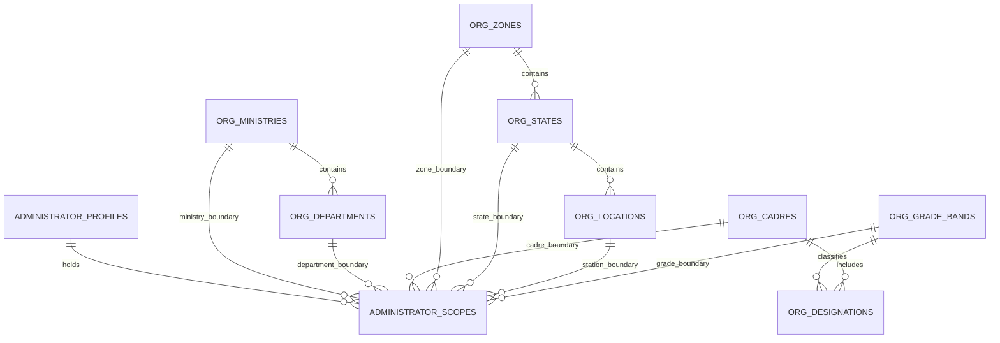
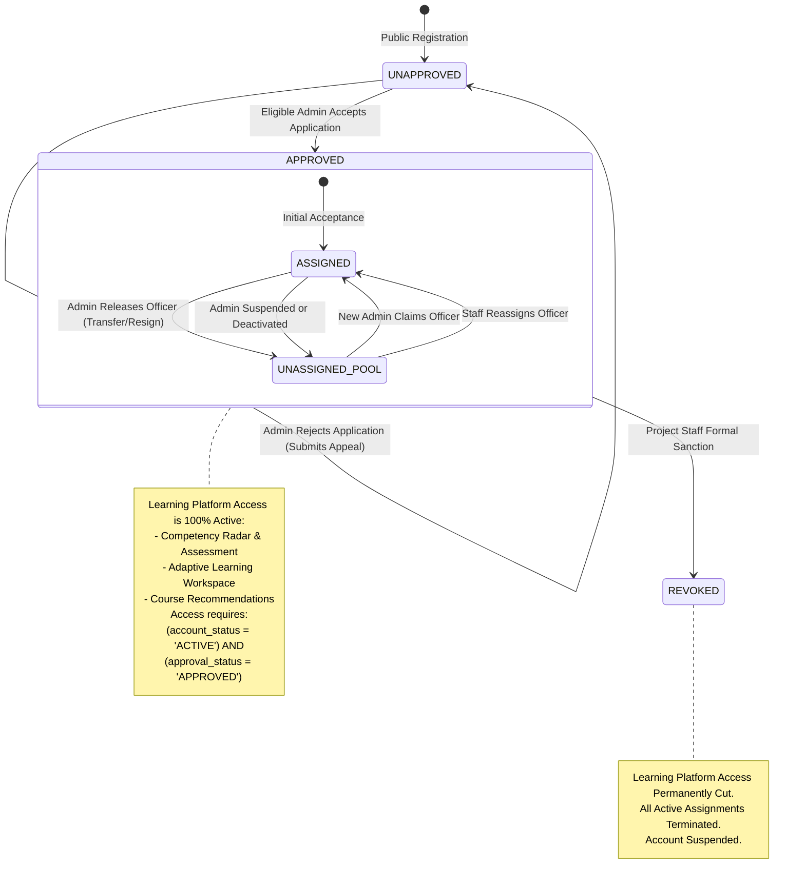
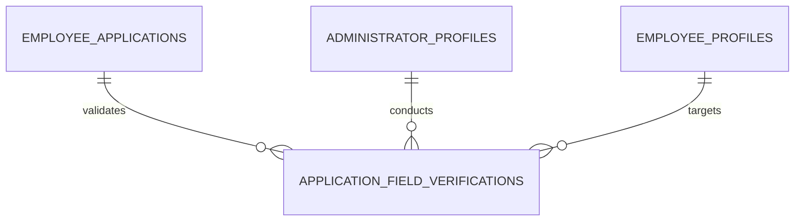

# SIH26101 — Final Architecture and Implementation Plan (v2.5)

**Project:** Official Statistics Competency Intelligence and Adaptive Learning Platform  
**System ID:** SIH26101  
**Repository Root:** `d:/Projects/SIH26101/SIH26101-Integrated`  
**Revision:** v2.5 (Final Technical Consistency Specification)  
**Status:** Comprehensive Architecture Blueprint Complete • Formally Recommended for Approval  
**Database Engine Standard:** PostgreSQL 15+  

---

## 1. Verified Repository Facts vs. Executed Checks vs. Planned Tests

To maintain complete empirical rigor, all statements regarding system status are segregated into three explicit categories:

### Category A: Previously Verified Baseline Results (Conducted October 2026)
1. **Authoritative Datasets Verified by SHA-256 Hash:**
   - KCM Competencies: `backend/data/processed/competencies_kcm.json` (`9106ec27631dd0894f7b59133734266d7e9fd19ba0ef94107c082b6b32c90fd4`).
   - ACBP Courses: `backend/data/processed/acbp_courses.json` (`ec6ec89a68cb0bc3aecb777f00a156cda1898d2392b5fd2a7a09cc1e8fe159e7`).
   - Mappings Registry: `backend/data/processed/acbp_kcm_mappings.json` (`606926ad073e0e2a5682697f60c66c1867da908d57f5d2c53b1c2e596b5360f2`).
2. **Prior Pytest Run (Baseline Audit):**
   - Command: `python -m pytest --tb=short -q` in `backend/`.
   - Result: 260 passed, 1 warning (Starlette `httpx` deprecation) in 13.12s. Zero regressions.
3. **Prior Frontend TypeScript Check & Build:**
   - Command: `npx tsc --noEmit` and `npm run build` in `frontend/`.
   - Result: Clean compilation, 0 type errors, production bundle built in 16.47s.

### Category B: Checks Actually Executed During the v2.5 Architecture Review
1. **Working Copy Porcelain Status Check:**
   - Command: `git status --porcelain`.
   - Result: Verified that all 14 modified files and untracked documentation files remain intact and untouched. No working-tree modifications were discarded or altered.
2. **Source Inspections:**
   - Inspected `backend/competency_engine/api.py`, `backend/competency_engine/models.py`, `docs/FINAL_ARCHITECTURE_PLAN_v2.4.md`, `frontend/src/context/AppContext.tsx`, and `frontend/src/services/api.ts`.

### Category C: Planned Future Tests (To Be Executed During Implementation)
- All PostgreSQL 15+ database integration tests (`test_admin_capacity_concurrency_race.py`, `test_location_scope_boundaries.py`, `test_secure_document_vault.py`, `test_routing_history_atomic_transitions.py`, `test_employee_approval_and_revocation_lifecycle.py`, `test_field_level_verification_enforcement.py`, `test_audit_immutability_enforcement.py`).
- **No database tests have been run yet because implementation has not been authorized.**

---

## 2. Detailed Changelog: Revision v2.4 vs. Revision v2.5

| # | Review Finding / Inconsistency in v2.4 | Final Resolution in v2.5 | Impact on System |
|---|---|---|---|
| **1** | **Geographic Scope Relational Integrity** | `administrator_scopes` lacked explicit composite foreign keys referencing parent tables for zone, state, and station. | Added composite foreign-key constraints referencing `org_zones(id)`, `org_states(id, zone_id)`, and `org_locations(id, state_id, zone_id)`. Coupled with `chk_geographic_level_integrity`. | Mathematically prevents invalid geographic combinations (e.g., location in State X paired with State Y, or state in Zone A paired with Zone B). |
| **2** | **Secure Employment Document Architecture** | Document uploads were described at a high level without an end-to-end security specification. | Engineered AES-256-GCM envelope encryption at rest, storage outside web root (`backend/data/secure_vault/`), magic byte inspection, ClamAV anti-malware hook, streaming access control, quarantine staging, crypto-shredding retention, and Git-ignore protections. Clarified registration submission vs. mandatory admin inspection. | Guarantees military-grade privacy and protection for civil service credential documents without false claims of national e-KYC. |
| **3** | **Atomic Routing History Transitions** | Routing transitions lacked a formal atomic state machine to govern winning vs. competing routing records. | Defined exact atomic transitions: winning record moves to `COMPLETED_ACCEPTED` / `COMPLETED_REJECTED`, competing records move to `SUPERSEDED` / `WITHDRAWN`. Acceptance verifies caller owns an `ACTIVE` routing entry under row lock. Stale entries abort with `409 Conflict`. | Eliminates queue race conditions; stale administrative dashboard views cannot execute invalid acceptances. |
| **4** | **Independent Approval Lifecycle & Revocation** | Approval states lacked explicit specification for formal revocation, subsequent transfer applications, and separation from account authentication. | Defined exhaustive 3-tier state model (`UNAPPROVED`, `APPROVED`, `REVOKED`). Clarified that releases and transfers preserve `APPROVED` status. Formal revocation is restricted strictly to Project Staff, cascading to immediate assignment deactivation and learning access termination. | Decouples account login, employee approval, and administrative supervision into distinct, robust lifecycles. |
| **5** | **Field-Level Verification Model** | Verification was limited to a generic boolean checklist in application acceptance payload. | Introduced normalized `application_field_verifications` model capturing field-by-field employee-submitted values, admin-verified values, evidence references, outcomes (`VERIFIED_MATCH`, `VERIFIED_CORRECTED`, `DISCREPANCY_FLAGGED`), notes, and timestamps. Mandatory verification checklist required prior to acceptance. | Creates a tamper-evident, granular audit trail of employment qualification verification. |

---

## 3. Updated Geographic Hierarchy & Administrator Scope Model



### A. Normalized Geographic Tables with Composite Relational Integrity
```sql
CREATE TYPE geographic_level_enum AS ENUM ('NATIONAL', 'ZONE', 'STATE', 'STATION');

CREATE TABLE org_zones (
    id VARCHAR(32) PRIMARY KEY, -- e.g. 'ZONE_HQ', 'ZONE_NORTH', 'ZONE_SOUTH', 'ZONE_EAST', 'ZONE_WEST'
    name VARCHAR(100) NOT NULL,
    code VARCHAR(50) UNIQUE NOT NULL
);

CREATE TABLE org_states (
    id VARCHAR(32) NOT NULL, -- e.g. 'STATE_DL', 'STATE_WB', 'STATE_MH'
    zone_id VARCHAR(32) NOT NULL REFERENCES org_zones(id) ON DELETE RESTRICT,
    name VARCHAR(100) NOT NULL,
    code VARCHAR(10) NOT NULL,
    PRIMARY KEY (id, zone_id),
    CONSTRAINT uq_state_id UNIQUE (id)
);
CREATE INDEX idx_states_zone ON org_states(zone_id);

CREATE TABLE org_locations (
    id VARCHAR(32) NOT NULL, -- e.g. 'LOC_DEL_SPB', 'LOC_KOL_MB'
    state_id VARCHAR(32) NOT NULL,
    zone_id VARCHAR(32) NOT NULL,
    city VARCHAR(100) NOT NULL,
    building_name VARCHAR(255) NOT NULL,
    pin_code VARCHAR(10) NULL,
    PRIMARY KEY (id, state_id, zone_id),
    CONSTRAINT uq_location_id UNIQUE (id),
    -- Guarantees location's state belongs to the stated zone
    FOREIGN KEY (state_id, zone_id) REFERENCES org_states(id, zone_id) ON DELETE RESTRICT
);
CREATE INDEX idx_locations_state ON org_locations(state_id, zone_id);
```

### B. Administrator Scope Table with Explicit Composite Foreign Keys
```sql
CREATE TABLE administrator_scopes (
    id UUID PRIMARY KEY DEFAULT gen_random_uuid(),
    admin_id UUID NOT NULL REFERENCES administrator_profiles(id) ON DELETE CASCADE,
    
    -- Organizational boundaries
    ministry_id VARCHAR(32) NOT NULL REFERENCES org_ministries(id) ON DELETE RESTRICT,
    department_id VARCHAR(32) NULL,
    cadre_id VARCHAR(32) NULL REFERENCES org_cadres(id) ON DELETE RESTRICT,
    grade_band_id VARCHAR(32) NULL REFERENCES org_grade_bands(id) ON DELETE RESTRICT,
    
    -- Geographic boundaries (Mutually Exclusive Tiers)
    geographic_level geographic_level_enum NOT NULL,
    zone_id VARCHAR(32) NULL,
    state_id VARCHAR(32) NULL,
    location_id VARCHAR(32) NULL,
    
    created_at TIMESTAMPTZ NOT NULL DEFAULT NOW(),
    
    -- Organizational composite foreign key
    FOREIGN KEY (department_id, ministry_id) REFERENCES org_departments(id, ministry_id) ON DELETE RESTRICT,
    
    -- Explicit Geographic Composite Foreign Keys
    FOREIGN KEY (zone_id) REFERENCES org_zones(id) ON DELETE RESTRICT,
    FOREIGN KEY (state_id, zone_id) REFERENCES org_states(id, zone_id) ON DELETE RESTRICT,
    FOREIGN KEY (location_id, state_id, zone_id) REFERENCES org_locations(id, state_id, zone_id) ON DELETE RESTRICT,
    
    -- Strict geographic level integrity constraint
    CONSTRAINT chk_geographic_level_integrity CHECK (
        (geographic_level = 'NATIONAL' AND zone_id IS NULL AND state_id IS NULL AND location_id IS NULL) OR
        (geographic_level = 'ZONE'     AND zone_id IS NOT NULL AND state_id IS NULL AND location_id IS NULL) OR
        (geographic_level = 'STATE'    AND zone_id IS NOT NULL AND state_id IS NOT NULL AND location_id IS NULL) OR
        (geographic_level = 'STATION'  AND zone_id IS NOT NULL AND state_id IS NOT NULL AND location_id IS NOT NULL)
    ),
    
    -- PostgreSQL 15+ Unique Constraint
    CONSTRAINT uq_admin_scope_unique 
        UNIQUE NULLS NOT DISTINCT (admin_id, ministry_id, department_id, cadre_id, grade_band_id, geographic_level, zone_id, state_id, location_id)
);
```

### Mathematical Proof of Geographic Integrity
1. **NATIONAL:** `zone_id`, `state_id`, and `location_id` are strictly `NULL`. No foreign keys fire. Universal national jurisdiction within the specified Ministry.
2. **ZONE:** `zone_id` is `NOT NULL`; `state_id` and `location_id` are strictly `NULL`. `FOREIGN KEY (zone_id)` verifies that `zone_id` exists in `org_zones`. The composite FKs for state and station evaluate to true under PostgreSQL standard `MATCH SIMPLE` semantics because their child components are `NULL`.
3. **STATE:** `zone_id` and `state_id` are `NOT NULL`; `location_id` is strictly `NULL`. `FOREIGN KEY (state_id, zone_id) REFERENCES org_states(id, zone_id)` enforces that the state exists AND belongs to the specified zone. An administrator cannot be assigned State MH with Zone North.
4. **STATION:** `zone_id`, `state_id`, and `location_id` are all `NOT NULL`. `FOREIGN KEY (location_id, state_id, zone_id) REFERENCES org_locations(id, state_id, zone_id)` enforces that the station building exists AND belongs to the specified state AND zone.
5. Inconsistent combinations (e.g., Station in Mumbai assigned with State DL or Zone South) are physically rejected by the PostgreSQL engine with foreign key violation errors.

---

## 4. Secure Employment Document Storage Architecture

```
┌─────────────────────────────────────────────────────────────────────────────┐
│                       DOCUMENT INGESTION & ACCESS PIPELINE                  │
└─────────────────────────────────────────────────────────────────────────────┘
  Employee / Applicant                           Secure Vault (Outside Web Root)
       │                                                       │
       │ 1. Multipart POST (Max 5 MB)                          │
       ├──────────────────────────────────────┐                │
       │                                      ▼                │
       │                           [Staging Area: .tmp]        │
       │                                      │                │
       │                           2. Magic Byte Sniffing      │
       │                              (PDF, PNG, JPEG)         │
       │                                      │                │
       │                           3. Anti-Malware Scan        │
       │                              (ClamAV Daemon)          │
       │                                      │                │
       │                           4. AES-256-GCM Encryption   │
       │                              (DEK wrapped by KEK)     │
       │                                      │                │
       │                           5. Atomic Move (os.replace) │
       │                                      ├───────────────►│ backend/data/secure_vault/
       │                                                       │  evidence/{emp_id}/{doc_id}.enc
       ▼                                                       │
  Reviewing Administrator                                      │
       │ 6. Authenticated GET (Active Routing Required)        │
       ├───────────────────────────────────────────────────────┤
       │ 7. Audit Event Logged: VERIFICATION_DOC_ACCESSED      │
       │ 8. On-the-fly Decryption & Streaming Chunk Response   │
       ◄───────────────────────────────────────────────────────┘
```

### A. Storage Directory Layout & Git Isolation
All employment verification documents are stored strictly outside public web-accessible roots:
- **Vault Root:** `backend/data/secure_vault/employment_evidence/{employee_id}/{document_id}.enc`
- **Temporary Staging:** `backend/data/secure_vault/staging/{staging_uuid}.tmp`
- **Git Commit Immunity:**
  - `backend/data/secure_vault/` and `backend/data/uploads/` are added to `.gitignore`.
  - Directory contains `.gitkeep` with explicit negative ignore rules (`*` followed by `!.gitkeep`).
  - Pre-commit hook enforces that no file within `backend/data/secure_vault/` or matching `*.enc` can be staged or committed.

### B. Encryption at Rest (Envelope Architecture)
1. **Cryptographic Standard:** AES-256-GCM (Galois/Counter Mode) providing authenticated encryption with associated data (AEAD).
2. **Key Hierarchy:**
   - **Key Encryption Key (KEK):** 256-bit master secret managed via environment configuration (`DOCUMENT_ENCRYPTION_SECRET`) or hardware security module (HSM).
   - **Data Encryption Key (DEK):** Unique 256-bit cryptographically secure pseudorandom key generated per document (`secrets.token_bytes(32)`).
3. **Payload Structure on Disk:**
   `[12-byte Nonce/IV] + [16-byte GCM Authentication Tag] + [Encrypted DEK (wrapped by KEK)] + [Encrypted Document Ciphertext]`
4. **Tamper Detection:** If the ciphertext or headers are altered on disk, AES-GCM tag verification fails immediately, aborting the read with an audit security alert.

### C. Ingestion, Validation & Anti-Malware Pipeline
1. **Size Limit:** Strictly enforced at reverse proxy (Nginx `client_max_body_size 5M`) and FastAPI streaming chunk intake (5,242,880 bytes).
2. **File Signature & Magic Byte Sniffing (Never Trust File Extensions or Client Headers):**
   - **PDF:** First 4 bytes must match `%PDF-` (`0x25 0x50 0x44 0x46`).
   - **PNG:** First 8 bytes must match `\x89PNG\r\n\x1a\n` (`0x89 0x50 0x4E 0x47 0x0D 0x0A 0x1A 0x0A`).
   - **JPEG:** First 3 bytes must match `\xFF\xD8\xFF` (`0xFF 0xD8 0xFF`).
   - All other formats, polyglots, SVG (XSS vector), HTML, executables, and archive files are rejected immediately with `HTTP 422 Unprocessable Entity`.
3. **Malware Scanning:**
   - Production pipeline streams incoming payload to ClamAV daemon (`clamd` over UNIX or TCP socket).
   - Development sandbox uses an isolated byte-signature scanner stub.
   - Any infected payload causes immediate file zeroing, deletion from staging, and an audit warning.
4. **Atomic Staging and Orphan Cleanup:**
   - Uploads are written to `backend/data/secure_vault/staging/{uuid}.tmp`.
   - Inspection, scanning, and encryption occur in staging.
   - Once database transaction commits, the file is atomically moved (`os.replace`) to the final vault destination.
   - An asynchronous background task sweeps `staging/` every 60 minutes and deletes orphaned `.tmp` files older than 2 hours.

### D. Access Control, Streaming Delivery & Audit
1. **Zero Direct Web Access:** The directory is never mounted or served as static assets.
2. **Streaming Endpoint:** `GET /api/admin/pending-applications/{id}/document`.
3. **Authorization Guard:** Caller must possess a valid JWT, and satisfy at least one condition:
   - Caller is the employee who submitted the document.
   - Caller is an Administrator who currently owns an `ACTIVE` routing record for that application.
   - Caller is Project Staff (`account_type = 'PROJECT_STAFF'`).
4. **Security Headers on Stream:**
   - `Content-Disposition: attachment; filename="employment_evidence_{id}.pdf"`
   - `X-Content-Type-Options: nosniff`
   - `Cache-Control: private, no-cache, no-store, must-revalidate`
5. **Audit Logging:** Every view or download creates an immutable record in `application_audit_logs`:
   - `action = 'VERIFICATION_DOC_ACCESSED'`
   - `actor_id = caller.id`, `actor_role = caller.account_type`, `ip_address = client_ip`

### E. Retention, Crypto-Shredding & Deletion Policy
- **Active Retention:** Preserved throughout the employee's active service.
- **Crypto-Shredding:** Upon approved account deletion or Right to Erasure, the encrypted DEK is permanently destroyed from the database and key store. The ciphertext on disk becomes mathematically impossible to decrypt, followed by filesystem block overwriting (`shred` / secure unlink).

### F. Submission Timing & Identity Verification Caveat
1. **Submission Timing Clarification:**
   - Document upload is **optional during initial public registration** to minimize signup friction.
   - **Administrator acceptance strictly requires document inspection and verification.**
   - If an applicant does not upload evidence at registration, the Administrator uses `POST /api/admin/pending-applications/{id}/request-evidence` to place the application in `EVIDENCE_REQUESTED` state and send a secure upload link to the applicant.
2. **Sovereign Identity Caveat:**
   - Uploading an employee ID or posting order constitutes **Documentary Proof of Employment**, NOT sovereign statutory identity verification (e.g. Aadhaar eKYC, Parichay SSO). The platform makes no claim of sovereign identity verification until Parichay/e-Pramaan integration is formally certified.

---

## 5. Complete Routing History & Queue Lifecycle

To guarantee no stale routing entries can authorize an acceptance, routing records are modeled as a strict state machine:

```mermaid
stateDiagram-v2
    [*] --> ACTIVE : Automatic Match or Staff Routing
    
    state ACTIVE {
        note right of ACTIVE
          Administrator sees application in
          their Pending Applications queue.
        end note
    }
    
    ACTIVE --> COMPLETED_ACCEPTED : Assigned Admin Accepts (Winner)
    ACTIVE --> COMPLETED_REJECTED : Assigned Admin Rejects (Winner)
    ACTIVE --> SUPERSEDED : Competing Admin Accepts Application
    ACTIVE --> SUPERSEDED : Staff Reroutes to Different Admin
    ACTIVE --> WITHDRAWN : Applicant Resubmits or Withdraws
    
    COMPLETED_ACCEPTED --> [*]
    COMPLETED_REJECTED --> [*]
    SUPERSEDED --> [*]
    WITHDRAWN --> [*]
```

### A. Routing Status State Definitions
- `ACTIVE`: The application is visible in the Administrator's review queue.
- `COMPLETED_ACCEPTED`: The winning Administrator whose acceptance transaction was committed.
- `COMPLETED_REJECTED`: The Administrator whose rejection transaction was committed.
- `SUPERSEDED`: Another pooled Administrator accepted the application first, or Project Staff rerouted the application to a new administrator.
- `WITHDRAWN`: The application was withdrawn or canceled by the applicant or system.

### B. Atomic Transactional Acceptance Protocol
When an Administrator calls `POST /api/admin/pending-applications/{id}/accept`:
```
BEGIN TRANSACTION ISOLATION LEVEL READ COMMITTED;
  1. Lock Application row:
     SELECT * FROM employee_applications WHERE id = :app_id FOR UPDATE;
     Verify status IN ('SUBMITTED', 'ROUTED_PENDING_REVIEW');
     
  2. Lock Administrator Profile row:
     SELECT * FROM administrator_profiles WHERE id = :admin_id FOR UPDATE;
     Verify is_active = TRUE;
     
  3. Validate Routing Staleness:
     SELECT id, routing_status FROM application_routing_history
     WHERE application_id = :app_id AND admin_id = :admin_id AND routing_status = 'ACTIVE'
     FOR UPDATE;
     --> If absent or status != 'ACTIVE':
         ROLLBACK;
         RETURN 409 Conflict ("Stale routing: Application already claimed, accepted, or rerouted.");
         
  4. Verify Capacity Constraint:
     SELECT COUNT(*) FROM admin_employee_assignments 
     WHERE admin_id = :admin_id AND is_active = TRUE;
     --> If count >= max_managed_employees:
         ROLLBACK;
         RETURN 409 Conflict ("Administrator capacity limit reached.");
         
  5. Verify Mandatory Field Verification Checklist:
     Verify all 6 mandatory fields exist in application_field_verifications 
     with outcome IN ('VERIFIED_MATCH', 'VERIFIED_CORRECTED').
     --> If incomplete:
         ROLLBACK;
         RETURN 422 Unprocessable Entity ("Mandatory verification fields incomplete.");
         
  6. Transition Winning Routing Record:
     UPDATE application_routing_history 
     SET routing_status = 'COMPLETED_ACCEPTED', resolved_at = NOW(), resolution_notes = 'Application accepted'
     WHERE application_id = :app_id AND admin_id = :admin_id;
     
  7. Transition Competing Active Routing Records:
     UPDATE application_routing_history 
     SET routing_status = 'SUPERSEDED', resolved_at = NOW(), resolution_notes = 'Claimed by another administrator'
     WHERE application_id = :app_id AND admin_id != :admin_id AND routing_status = 'ACTIVE';
     
  8. Update Application Record:
     UPDATE employee_applications 
     SET status = 'ACCEPTED', reviewed_by_admin_id = :admin_id, reviewed_at = NOW()
     WHERE id = :app_id;
     
  9. Establish Employee Approval:
     UPDATE employee_profiles 
     SET approval_status = 'APPROVED', approved_at = NOW(), approved_by_admin_id = :admin_id
     WHERE id = app.employee_id;
     
  10. Create Active Supervisory Assignment:
      INSERT INTO admin_employee_assignments (admin_id, employee_id, assignment_source, is_active, assigned_at)
      VALUES (:admin_id, app.employee_id, 'ADMIN_ACCEPTANCE', TRUE, NOW());
      
  11. Commit Immutable Audit Event:
      INSERT INTO application_audit_logs (application_id, actor_id, actor_email, actor_role, action, new_state)
      VALUES (:app_id, :admin_id, :admin_email, 'ADMINISTRATOR', 'APPLICATION_ACCEPTED', ...);
COMMIT;
```

---

## 6. Authoritative Employee Approval Lifecycle

The platform strictly decouples **Account Authentication**, **Employee Approval**, and **Administrative Supervisory Assignment** into three independent dimensions:



### A. Independence Matrix of System Dimensions

| Dimension | Database Column | Possible States | Managing Authority | Effect on Platform Learning Access |
|---|---|---|---|---|
| **Account Authentication** | `users.account_status` | `UNVERIFIED_EMAIL`, `ACTIVE`, `SUSPENDED`, `DEACTIVATED` | Auth Service / Project Staff | If not `ACTIVE`, user cannot log in. |
| **Employee Approval** | `employee_profiles.approval_status` | `UNAPPROVED`, `APPROVED`, `REVOKED` | Eligible Administrator (Approval) / Project Staff (Revocation) | If not `APPROVED`, user is blocked from learning workspace (`403 Forbidden`). |
| **Supervisory Assignment** | `admin_employee_assignments.is_active` | `TRUE`, `FALSE` | Administrator (Claim/Release) / Project Staff (Reassign) | **Zero effect on learning access.** Only determines administrative supervision. |
| **Onboarding Pipeline** | `employee_applications.status` | `SUBMITTED`, `ROUTED_PENDING_REVIEW`, `EVIDENCE_REQUESTED`, `ACCEPTED`, `REJECTED`, `ESCALATED_UNMATCHED` | Routing Engine / Administrator | Governs onboarding/transfer application workflow. |

### B. Valid Transitions for `approval_status`
1. **Initial Registration:** Set to `UNAPPROVED`.
2. **First Acceptance:** Moves from `UNAPPROVED` $\rightarrow$ `APPROVED` upon commit of administrator acceptance.
3. **Rejection Before Approval:** Remains `UNAPPROVED`. The application record is marked `REJECTED`. The employee may submit an appeal/resubmission (`submission_number + 1`), creating a new application while `approval_status` remains `UNAPPROVED`.
4. **Employee Release (Transfer / Departure):** Administrator executes `POST /api/admin/assigned-employees/{id}/release`. The assignment is deactivated (`is_active = FALSE`), but `approval_status` **strictly remains `APPROVED`**. The officer enters the unassigned approved pool. Learning workspace access remains 100% functional.
5. **Administrator Reassignment:** Project Staff executes `POST /api/project-staff/employees/{id}/reassign` or a new Administrator claims the officer. The active assignment transfers, and `approval_status` **remains `APPROVED`**.
6. **Subsequent Internal Transfer Applications:** An approved employee applying for an internal transfer or cadre change creates a new application row (`submission_number + 1`). Their `approval_status` **remains `APPROVED`** during review; their existing learning access is uninterrupted.
7. **Formal Approval Revocation:**
   - **Authorized Actor:** Strictly Project Staff (`account_type = 'PROJECT_STAFF'`) with mandatory justification ($\ge 20$ characters).
   - **Endpoint:** `POST /api/project-staff/employees/{id}/revoke-approval`.
   - **Cascading Effects:**
     - `employee_profiles.approval_status` set to `REVOKED`.
     - Active assignment in `admin_employee_assignments` deactivated (`is_active = FALSE`, `revocation_reason = 'APPROVAL_REVOKED_BY_STAFF'`).
     - `users.account_status` set to `SUSPENDED`.
     - All active JWT refresh tokens revoked in `refresh_tokens`.
     - Immediate termination of learning workspace, quizzes, assessments, and recommendations (`403 Forbidden`).
     - Immutable audit record emitted: `EMPLOYEE_APPROVAL_REVOKED`.

---

## 7. Field-Level Employee Verification Model

To ensure tamper-evident provenance of employee credentials, individual profile fields undergo discrete administrator verification before an application can be accepted.



### A. Normalized Relational Verification Schema
```sql
CREATE TYPE verification_outcome_enum AS ENUM (
    'VERIFIED_MATCH', 
    'VERIFIED_CORRECTED', 
    'DISCREPANCY_FLAGGED', 
    'UNVERIFIABLE'
);

CREATE TABLE application_field_verifications (
    id UUID PRIMARY KEY DEFAULT gen_random_uuid(),
    application_id UUID NOT NULL REFERENCES employee_applications(id) ON DELETE RESTRICT,
    employee_id UUID NOT NULL REFERENCES employee_profiles(id) ON DELETE RESTRICT,
    field_name VARCHAR(64) NOT NULL, -- e.g. 'EMPLOYEE_CODE', 'CADRE', 'DESIGNATION', 'DEPARTMENT', 'DUTY_STATION', 'EMPLOYMENT_DOCUMENT'
    employee_submitted_value JSONB NOT NULL,
    admin_verified_value JSONB NOT NULL,
    evidence_reference VARCHAR(255) NULL, -- Document ID, establishment roll serial, or official gazette ref
    verification_outcome verification_outcome_enum NOT NULL,
    reviewing_admin_id UUID NOT NULL REFERENCES administrator_profiles(id) ON DELETE RESTRICT,
    verified_at TIMESTAMPTZ NOT NULL DEFAULT NOW(),
    notes TEXT NULL,
    created_at TIMESTAMPTZ NOT NULL DEFAULT NOW(),
    
    -- Exactly one verification entry per field per application version
    CONSTRAINT uq_app_field_verification UNIQUE (application_id, field_name)
);
CREATE INDEX idx_verifications_app ON application_field_verifications(application_id);
```

### B. Mandatory Verification Checklist
Before an application can be accepted, the reviewing Administrator must attest to all six mandatory fields:
1. `EMPLOYEE_CODE`: Government employee identity number / PRAN / PFMS code.
2. `CADRE`: Official service cadre (e.g. SSS, ISS, Subordinate).
3. `DESIGNATION`: Official post and grade band.
4. `MINISTRY_DEPARTMENT`: Ministry and Department/Attached Office.
5. `DUTY_STATION`: Posting location, city, and office station building.
6. `EMPLOYMENT_DOCUMENT`: Inspection of official posting order or government photo ID card.

### C. Acceptance Verification Guard
In `POST /api/admin/pending-applications/{id}/accept`, the backend executes:
```sql
SELECT field_name, verification_outcome 
FROM application_field_verifications 
WHERE application_id = :app_id;
```
- **Rule 1:** All 6 mandatory fields must be present in the query results.
- **Rule 2:** Every mandatory field must have `verification_outcome IN ('VERIFIED_MATCH', 'VERIFIED_CORRECTED')`.
- If any mandatory field is missing or has outcome `DISCREPANCY_FLAGGED` or `UNVERIFIABLE`, the transaction aborts with `HTTP 422 Unprocessable Entity`:
  `"Cannot accept application: Mandatory field '{field_name}' has unresolved outcome '{outcome}'."`
- **Correction Persistence:** If a field has outcome `VERIFIED_CORRECTED`, the administrator-verified value is automatically synchronized to `employee_profiles` upon acceptance, ensuring official establishment records prevail.

---

## 8. Orthogonal 100-Point Matching Algorithm (Zero Double-Counting)

An administrator's score is evaluated against their **best matching scope** $S_{\text{best}}$ across four mutually exclusive, orthogonal axes:

$$\text{Final Rank Score} = S_{\text{geo}} + S_{\text{dept}} + S_{\text{cadre\_grade}} + S_{\text{workload}}$$

```
┌────────────────────────────────────────────────────────────────────────┐
│ Axis 1: Geographic Proximity (Max 35 pts) — Mutually Exclusive Tiers   │
│  - STATION Level Match (Exact Station / Office Building):      35 pts  │
│  - STATE Level Match (Station differs, State matches):         25 pts  │
│  - ZONE Level Match (State differs, Regional Zone matches):    15 pts  │
│  - NATIONAL Level Scope (Universal National Authority):         5 pts  │
├────────────────────────────────────────────────────────────────────────┤
│ Axis 2: Organizational Unit Proximity (Max 35 pts)                     │
│  - Department-Specific Scope (Exact Department / Attached Off):35 pts  │
│  - Ministry-Wide Scope (Universal Ministry Authority):         15 pts  │
├────────────────────────────────────────────────────────────────────────┤
│ Axis 3: Cadre & Grade Alignment (Max 20 pts)                           │
│  - Dedicated Cadre Oversight (cadre_id IS NOT NULL):           12 pts  │
│  - Cadre Wildcard (cadre_id IS NULL):                           4 pts  │
│  - Dedicated Grade Band Authority (grade_band_id IS NOT NULL):  8 pts  │
│  - Grade Band Wildcard (grade_band_id IS NULL):                 2 pts  │
├────────────────────────────────────────────────────────────────────────┤
│ Axis 4: Workload Margin (Max 10 pts) — Hard Capacity Gated             │
│  - If Current Active Load >= Max Capacity: DISQUALIFIED (Score = 0)    │
│  - If Current Active Load < Max Capacity:                              │
│      10.0 * (1.0 - (Current Active Load / Max Capacity))               │
└────────────────────────────────────────────────────────────────────────┘
Total Maximum Score: 35 + 35 + 12 + 8 + 10 = 100 points
```

### Deterministic Tie-Breaking
1. Higher Geographic Proximity Score ($S_{\text{geo}}$).
2. Higher Departmental Proximity Score ($S_{\text{dept}}$).
3. Higher Available Capacity Margin ($C_{\text{max}} - C_{\text{curr}}$).
4. Administrator Profile Seniority (`created_at ASC`).
5. Lexicographical UUID tie-breaker (`admin_id ASC`).

---

## 9. Complete PostgreSQL 15+ Schema (v2.5 Master DDL)

```sql
-- SIH26101 Master Relational Schema v2.5 (PostgreSQL 15+)
CREATE EXTENSION IF NOT EXISTS "pgcrypto";

-- Enums
CREATE TYPE account_type_enum AS ENUM ('EMPLOYEE', 'ADMINISTRATOR', 'PROJECT_STAFF');
CREATE TYPE account_status_enum AS ENUM ('UNVERIFIED_EMAIL', 'ACTIVE', 'SUSPENDED', 'DEACTIVATED');
CREATE TYPE app_status_enum AS ENUM ('SUBMITTED', 'ROUTED_PENDING_REVIEW', 'EVIDENCE_REQUESTED', 'ACCEPTED', 'REJECTED', 'ESCALATED_UNMATCHED');
CREATE TYPE approval_status_enum AS ENUM ('UNAPPROVED', 'APPROVED', 'REVOKED');
CREATE TYPE geographic_level_enum AS ENUM ('NATIONAL', 'ZONE', 'STATE', 'STATION');
CREATE TYPE routing_status_enum AS ENUM ('ACTIVE', 'SUPERSEDED', 'WITHDRAWN', 'COMPLETED_ACCEPTED', 'COMPLETED_REJECTED');
CREATE TYPE routing_source_enum AS ENUM ('AUTOMATIC_MATCH', 'STAFF_MANUAL_ROUTE', 'STAFF_REASSIGNMENT');
CREATE TYPE verification_outcome_enum AS ENUM ('VERIFIED_MATCH', 'VERIFIED_CORRECTED', 'DISCREPANCY_FLAGGED', 'UNVERIFIABLE');

-- 1. Identity & Credentials
CREATE TABLE users (
    id UUID PRIMARY KEY DEFAULT gen_random_uuid(),
    email VARCHAR(255) UNIQUE NOT NULL,
    hashed_password VARCHAR(255) NOT NULL,
    account_type account_type_enum NOT NULL,
    account_status account_status_enum NOT NULL DEFAULT 'UNVERIFIED_EMAIL',
    failed_login_attempts INT NOT NULL DEFAULT 0 CHECK (failed_login_attempts >= 0),
    lockout_until TIMESTAMPTZ NULL,
    created_at TIMESTAMPTZ NOT NULL DEFAULT NOW(),
    updated_at TIMESTAMPTZ NOT NULL DEFAULT NOW()
);
CREATE INDEX idx_users_email ON users(email);

CREATE TABLE email_verifications (
    id UUID PRIMARY KEY DEFAULT gen_random_uuid(),
    user_id UUID NOT NULL REFERENCES users(id) ON DELETE RESTRICT,
    token_hash VARCHAR(64) UNIQUE NOT NULL,
    expires_at TIMESTAMPTZ NOT NULL,
    is_consumed BOOLEAN NOT NULL DEFAULT FALSE,
    consumed_at TIMESTAMPTZ NULL,
    created_at TIMESTAMPTZ NOT NULL DEFAULT NOW()
);

CREATE TABLE refresh_tokens (
    id UUID PRIMARY KEY DEFAULT gen_random_uuid(),
    user_id UUID NOT NULL REFERENCES users(id) ON DELETE RESTRICT,
    token_hash VARCHAR(64) UNIQUE NOT NULL,
    family_id UUID NOT NULL,
    is_revoked BOOLEAN NOT NULL DEFAULT FALSE,
    expires_at TIMESTAMPTZ NOT NULL,
    created_at TIMESTAMPTZ NOT NULL DEFAULT NOW()
);
CREATE INDEX idx_refresh_token_family ON refresh_tokens(family_id);

CREATE TABLE admin_invitations (
    id UUID PRIMARY KEY DEFAULT gen_random_uuid(),
    email VARCHAR(255) NOT NULL,
    token_hash VARCHAR(64) UNIQUE NOT NULL,
    official_designation VARCHAR(255) NOT NULL,
    authorized_scopes JSONB NOT NULL DEFAULT '[]',
    created_by_staff_id UUID NOT NULL REFERENCES users(id) ON DELETE RESTRICT,
    expires_at TIMESTAMPTZ NOT NULL,
    is_consumed BOOLEAN NOT NULL DEFAULT FALSE,
    consumed_at TIMESTAMPTZ NULL,
    created_at TIMESTAMPTZ NOT NULL DEFAULT NOW()
);

-- 2. Organizational Taxonomy
CREATE TABLE org_ministries (
    id VARCHAR(32) PRIMARY KEY,
    name VARCHAR(255) NOT NULL,
    code VARCHAR(50) UNIQUE NOT NULL,
    is_active BOOLEAN NOT NULL DEFAULT TRUE
);

CREATE TABLE org_departments (
    id VARCHAR(32) NOT NULL,
    ministry_id VARCHAR(32) NOT NULL REFERENCES org_ministries(id) ON DELETE RESTRICT,
    name VARCHAR(255) NOT NULL,
    code VARCHAR(50) NOT NULL,
    is_active BOOLEAN NOT NULL DEFAULT TRUE,
    PRIMARY KEY (id, ministry_id)
);

CREATE TABLE org_cadres (
    id VARCHAR(32) PRIMARY KEY,
    name VARCHAR(255) NOT NULL,
    controlling_authority VARCHAR(255) NOT NULL DEFAULT 'MoSPI',
    is_active BOOLEAN NOT NULL DEFAULT TRUE
);

CREATE TABLE org_grade_bands (
    id VARCHAR(32) PRIMARY KEY,
    name VARCHAR(100) NOT NULL,
    hierarchical_rank INT NOT NULL CHECK (hierarchical_rank >= 1)
);

CREATE TABLE org_designations (
    id VARCHAR(32) PRIMARY KEY,
    name VARCHAR(255) NOT NULL,
    grade_band_id VARCHAR(32) NOT NULL REFERENCES org_grade_bands(id) ON DELETE RESTRICT,
    cadre_id VARCHAR(32) NULL REFERENCES org_cadres(id) ON DELETE RESTRICT,
    is_active BOOLEAN NOT NULL DEFAULT TRUE
);

CREATE TABLE org_zones (
    id VARCHAR(32) PRIMARY KEY,
    name VARCHAR(100) NOT NULL,
    code VARCHAR(50) UNIQUE NOT NULL
);

CREATE TABLE org_states (
    id VARCHAR(32) NOT NULL,
    zone_id VARCHAR(32) NOT NULL REFERENCES org_zones(id) ON DELETE RESTRICT,
    name VARCHAR(100) NOT NULL,
    code VARCHAR(10) NOT NULL,
    PRIMARY KEY (id, zone_id),
    CONSTRAINT uq_state_id UNIQUE (id)
);

CREATE TABLE org_locations (
    id VARCHAR(32) NOT NULL,
    state_id VARCHAR(32) NOT NULL,
    zone_id VARCHAR(32) NOT NULL,
    city VARCHAR(100) NOT NULL,
    building_name VARCHAR(255) NOT NULL,
    pin_code VARCHAR(10) NULL,
    PRIMARY KEY (id, state_id, zone_id),
    CONSTRAINT uq_location_id UNIQUE (id),
    FOREIGN KEY (state_id, zone_id) REFERENCES org_states(id, zone_id) ON DELETE RESTRICT
);

-- 3. Profiles
CREATE TABLE employee_profiles (
    id UUID PRIMARY KEY DEFAULT gen_random_uuid(),
    user_id UUID UNIQUE NOT NULL REFERENCES users(id) ON DELETE RESTRICT,
    full_name VARCHAR(255) NOT NULL,
    ministry_id VARCHAR(32) NOT NULL,
    department_id VARCHAR(32) NOT NULL,
    cadre_id VARCHAR(32) NOT NULL REFERENCES org_cadres(id) ON DELETE RESTRICT,
    location_id VARCHAR(32) NOT NULL REFERENCES org_locations(id) ON DELETE RESTRICT,
    designation_id VARCHAR(32) NOT NULL REFERENCES org_designations(id) ON DELETE RESTRICT,
    experience_years NUMERIC(4, 1) NOT NULL CHECK (experience_years >= 0.0),
    phone_number VARCHAR(20) NULL,
    self_declared_skills JSONB NOT NULL DEFAULT '[]',
    supporting_document_path VARCHAR(512) NULL,
    approval_status approval_status_enum NOT NULL DEFAULT 'UNAPPROVED',
    approved_at TIMESTAMPTZ NULL,
    approved_by_admin_id UUID NULL,
    created_at TIMESTAMPTZ NOT NULL DEFAULT NOW(),
    updated_at TIMESTAMPTZ NOT NULL DEFAULT NOW(),
    FOREIGN KEY (department_id, ministry_id) REFERENCES org_departments(id, ministry_id) ON DELETE RESTRICT
);

CREATE TABLE administrator_profiles (
    id UUID PRIMARY KEY DEFAULT gen_random_uuid(),
    user_id UUID UNIQUE NOT NULL REFERENCES users(id) ON DELETE RESTRICT,
    full_name VARCHAR(255) NOT NULL,
    official_designation VARCHAR(255) NOT NULL,
    max_managed_employees INT NOT NULL DEFAULT 200 CHECK (max_managed_employees > 0),
    is_active BOOLEAN NOT NULL DEFAULT TRUE,
    created_at TIMESTAMPTZ NOT NULL DEFAULT NOW()
);

CREATE TABLE administrator_scopes (
    id UUID PRIMARY KEY DEFAULT gen_random_uuid(),
    admin_id UUID NOT NULL REFERENCES administrator_profiles(id) ON DELETE CASCADE,
    ministry_id VARCHAR(32) NOT NULL REFERENCES org_ministries(id) ON DELETE RESTRICT,
    department_id VARCHAR(32) NULL,
    cadre_id VARCHAR(32) NULL REFERENCES org_cadres(id) ON DELETE RESTRICT,
    grade_band_id VARCHAR(32) NULL REFERENCES org_grade_bands(id) ON DELETE RESTRICT,
    geographic_level geographic_level_enum NOT NULL,
    zone_id VARCHAR(32) NULL,
    state_id VARCHAR(32) NULL,
    location_id VARCHAR(32) NULL,
    created_at TIMESTAMPTZ NOT NULL DEFAULT NOW(),
    
    FOREIGN KEY (department_id, ministry_id) REFERENCES org_departments(id, ministry_id) ON DELETE RESTRICT,
    FOREIGN KEY (zone_id) REFERENCES org_zones(id) ON DELETE RESTRICT,
    FOREIGN KEY (state_id, zone_id) REFERENCES org_states(id, zone_id) ON DELETE RESTRICT,
    FOREIGN KEY (location_id, state_id, zone_id) REFERENCES org_locations(id, state_id, zone_id) ON DELETE RESTRICT,
    
    CONSTRAINT chk_geographic_level_integrity CHECK (
        (geographic_level = 'NATIONAL' AND zone_id IS NULL AND state_id IS NULL AND location_id IS NULL) OR
        (geographic_level = 'ZONE'     AND zone_id IS NOT NULL AND state_id IS NULL AND location_id IS NULL) OR
        (geographic_level = 'STATE'    AND zone_id IS NOT NULL AND state_id IS NOT NULL AND location_id IS NULL) OR
        (geographic_level = 'STATION'  AND zone_id IS NOT NULL AND state_id IS NOT NULL AND location_id IS NOT NULL)
    ),
    CONSTRAINT uq_admin_scope_unique 
        UNIQUE NULLS NOT DISTINCT (admin_id, ministry_id, department_id, cadre_id, grade_band_id, geographic_level, zone_id, state_id, location_id)
);

CREATE TABLE project_staff_profiles (
    id UUID PRIMARY KEY DEFAULT gen_random_uuid(),
    user_id UUID UNIQUE NOT NULL REFERENCES users(id) ON DELETE RESTRICT,
    full_name VARCHAR(255) NOT NULL,
    staff_role VARCHAR(100) NOT NULL DEFAULT 'Platform Lead',
    created_at TIMESTAMPTZ NOT NULL DEFAULT NOW()
);

-- 4. Versioned Applications & Routing Lifecycle
CREATE TABLE employee_applications (
    id UUID PRIMARY KEY DEFAULT gen_random_uuid(),
    employee_id UUID NOT NULL REFERENCES employee_profiles(id) ON DELETE RESTRICT,
    submission_number INT NOT NULL DEFAULT 1 CHECK (submission_number >= 1),
    parent_application_id UUID NULL,
    status app_status_enum NOT NULL DEFAULT 'SUBMITTED',
    decision_reason TEXT NULL,
    reviewed_at TIMESTAMPTZ NULL,
    reviewed_by_admin_id UUID NULL REFERENCES administrator_profiles(id) ON DELETE RESTRICT,
    created_at TIMESTAMPTZ NOT NULL DEFAULT NOW(),
    updated_at TIMESTAMPTZ NOT NULL DEFAULT NOW(),
    CONSTRAINT uq_app_id_employee UNIQUE (id, employee_id),
    CONSTRAINT uq_employee_submission UNIQUE (employee_id, submission_number),
    CONSTRAINT chk_no_self_parent CHECK (parent_application_id IS NULL OR parent_application_id != id),
    FOREIGN KEY (parent_application_id, employee_id) REFERENCES employee_applications(id, employee_id) ON DELETE RESTRICT
);

CREATE UNIQUE INDEX uq_single_pending_application_per_employee 
ON employee_applications (employee_id) 
WHERE status IN ('SUBMITTED', 'ROUTED_PENDING_REVIEW', 'EVIDENCE_REQUESTED', 'ESCALATED_UNMATCHED');

CREATE TABLE application_routing_history (
    id UUID PRIMARY KEY DEFAULT gen_random_uuid(),
    application_id UUID NOT NULL REFERENCES employee_applications(id) ON DELETE RESTRICT,
    admin_id UUID NOT NULL REFERENCES administrator_profiles(id) ON DELETE RESTRICT,
    routing_source routing_source_enum NOT NULL DEFAULT 'AUTOMATIC_MATCH',
    routing_status routing_status_enum NOT NULL DEFAULT 'ACTIVE',
    match_score NUMERIC(5, 2) NOT NULL CHECK (match_score >= 0.0 AND match_score <= 100.0),
    match_explanation JSONB NOT NULL,
    routed_by_actor_id UUID NULL REFERENCES users(id) ON DELETE SET NULL,
    staff_justification TEXT NULL,
    routed_at TIMESTAMPTZ NOT NULL DEFAULT NOW(),
    resolved_at TIMESTAMPTZ NULL,
    resolution_notes TEXT NULL
);
CREATE INDEX idx_routing_app_admin ON application_routing_history(application_id, admin_id);
CREATE INDEX idx_routing_active ON application_routing_history(admin_id, routing_status) WHERE routing_status = 'ACTIVE';

-- 5. Field-Level Verification Records
CREATE TABLE application_field_verifications (
    id UUID PRIMARY KEY DEFAULT gen_random_uuid(),
    application_id UUID NOT NULL REFERENCES employee_applications(id) ON DELETE RESTRICT,
    employee_id UUID NOT NULL REFERENCES employee_profiles(id) ON DELETE RESTRICT,
    field_name VARCHAR(64) NOT NULL,
    employee_submitted_value JSONB NOT NULL,
    admin_verified_value JSONB NOT NULL,
    evidence_reference VARCHAR(255) NULL,
    verification_outcome verification_outcome_enum NOT NULL,
    reviewing_admin_id UUID NOT NULL REFERENCES administrator_profiles(id) ON DELETE RESTRICT,
    verified_at TIMESTAMPTZ NOT NULL DEFAULT NOW(),
    notes TEXT NULL,
    created_at TIMESTAMPTZ NOT NULL DEFAULT NOW(),
    CONSTRAINT uq_app_field_verification UNIQUE (application_id, field_name)
);
CREATE INDEX idx_verifications_app ON application_field_verifications(application_id);

-- 6. Active Management Assignments
CREATE TABLE admin_employee_assignments (
    id UUID PRIMARY KEY DEFAULT gen_random_uuid(),
    admin_id UUID NOT NULL REFERENCES administrator_profiles(id) ON DELETE RESTRICT,
    employee_id UUID NOT NULL REFERENCES employee_profiles(id) ON DELETE RESTRICT,
    assignment_source VARCHAR(50) NOT NULL DEFAULT 'ADMIN_ACCEPTANCE',
    is_active BOOLEAN NOT NULL DEFAULT TRUE,
    assigned_at TIMESTAMPTZ NOT NULL DEFAULT NOW(),
    revoked_at TIMESTAMPTZ NULL,
    revocation_reason TEXT NULL
);

CREATE UNIQUE INDEX uq_single_active_assignment_per_employee 
ON admin_employee_assignments (employee_id) 
WHERE is_active = TRUE;

-- 7. Append-Only Audit Trail (Revoked UPDATE & DELETE)
CREATE TABLE application_audit_logs (
    id UUID PRIMARY KEY DEFAULT gen_random_uuid(),
    application_id UUID NOT NULL REFERENCES employee_applications(id) ON DELETE RESTRICT,
    actor_id UUID NULL REFERENCES users(id) ON DELETE SET NULL,
    actor_email VARCHAR(255) NOT NULL,
    actor_role VARCHAR(30) NOT NULL,
    action VARCHAR(50) NOT NULL,
    previous_state JSONB NULL,
    new_state JSONB NOT NULL,
    notes TEXT NULL,
    ip_address VARCHAR(45) NULL,
    created_at TIMESTAMPTZ NOT NULL DEFAULT NOW()
);
CREATE INDEX idx_audit_application ON application_audit_logs(application_id);

-- Enforce append-only permission at trigger level
CREATE OR REPLACE FUNCTION trg_prevent_audit_tampering()
RETURNS TRIGGER AS $$
BEGIN
    RAISE EXCEPTION 'COMPLIANCE VIOLATION: application_audit_logs is strictly append-only.';
END;
$$ LANGUAGE plpgsql;

CREATE TRIGGER trg_audit_immutability
BEFORE UPDATE OR DELETE ON application_audit_logs
FOR EACH ROW EXECUTE FUNCTION trg_prevent_audit_tampering();
```

---

## 10. Complete API Endpoint & Permission Matrix (All 32 Endpoints)

| # | HTTP Method | Endpoint | Allowed Roles | Preconditions & Guards | Approved Employee Required? | Jurisdiction Required? | Success Code | Error Codes | Audit Event |
|---|---|---|:---:|---|:---:|:---:|---|---|---|
| **1** | `POST` | `/api/auth/register` | PUB | Rate limit: 3/hr/IP; multipart with document | No | No | `201 Created` | `429`, `422` | `EMPLOYEE_REGISTERED` |
| **2** | `POST` | `/api/auth/verify-email` | PUB | Valid unconsumed token hash | No | No | `200 OK` | `400`, `410` | `EMAIL_VERIFIED` |
| **3** | `POST` | `/api/auth/login` | PUB | Valid credentials, active account | No | No | `200 OK` | `401`, `403` | `LOGIN_SUCCESS` / `FAILED` |
| **4** | `POST` | `/api/auth/refresh` | PUB | Valid refresh token | No | No | `200 OK` | `401` | `TOKEN_ROTATED` |
| **5** | `POST` | `/api/auth/logout` | ALL | Valid bearer token | No | No | `200 OK` | `401` | `LOGOUT` |
| **6** | `POST` | `/api/auth/password-reset/request` | PUB | Rate limit: 3/hr/IP; timing-safe | No | No | `200 OK` | `429` | `PW_RESET_REQUESTED` |
| **7** | `POST` | `/api/auth/password-reset/confirm` | PUB | Valid unconsumed reset token | No | No | `200 OK` | `400`, `410` | `PW_RESET_COMPLETED` |
| **8** | `GET` | `/api/auth/me` | ALL | Active authenticated session | No | No | `200 OK` | `401` | None |
| **9** | `GET` | `/api/employee/application-status` | EMP | User owns profile | No | No | `200 OK` | `404` | None |
| **10** | `PUT` | `/api/employee/profile` | EMP | User owns profile; updates secondary info | Yes | No | `200 OK` | `403`, `422` | `PROFILE_UPDATED` |
| **11** | `POST` | `/api/employee/resubmit-appeal` | EMP | Prior app `REJECTED`, no pending | No | No | `201 Created` | `409`, `422` | `APPLICATION_RESUBMITTED` |
| **12** | `POST` | `/api/employee/documents/upload` | EMP | Uploads missing/updated verification evidence | No | No | `200 OK` | `422`, `429` | `VERIFICATION_DOC_UPLOADED` |
| **13** | `POST` | `/api/employee/deactivate-account` | EMP | Authenticated password confirmation | No | No | `200 OK` | `401` | `ACCOUNT_DEACTIVATED` |
| **14** | `GET` | `/api/employee/learning-workspace` | EMP | Officer workspace aggregator | **Yes** | No | `200 OK` | `403 Forbidden` | None |
| **15** | `GET` | `/api/admin/pending-applications` | ADM | Scoped to caller's jurisdiction | N/A | **Yes** | `200 OK` | `403` | None |
| **16** | `GET` | `/api/admin/pending-applications/{id}/document`| ADM | Active routing record owned by caller | N/A | **Yes** | `200 OK` | `403`, `404` | `VERIFICATION_DOC_ACCESSED` |
| **17** | `GET` | `/api/admin/pending-applications/{id}/verifications`| ADM | Scoped to caller's jurisdiction | N/A | **Yes** | `200 OK` | `403` | None |
| **18** | `POST` | `/api/admin/pending-applications/{id}/verifications`| ADM | Records field verification outcomes | N/A | **Yes** | `200 OK` | `422`, `403` | `FIELD_VERIFICATION_RECORDED`|
| **19** | `POST` | `/api/admin/pending-applications/{id}/request-evidence`| ADM | Active routing; transitions to `EVIDENCE_REQUESTED`| N/A | **Yes** | `200 OK` | `409`, `403` | `EVIDENCE_REQUESTED` |
| **20** | `POST` | `/api/admin/pending-applications/{id}/accept` | ADM | Row-locked; admin capacity; checklist verified | N/A | **Yes** | `200 OK` | `409`, `403`, `422` | `APPLICATION_ACCEPTED` |
| **21** | `POST` | `/api/admin/pending-applications/{id}/reject` | ADM | Row-locked; reason $\ge 15$ chars | N/A | **Yes** | `200 OK` | `409`, `422` | `APPLICATION_REJECTED` |
| **22** | `GET` | `/api/admin/assigned-employees` | ADM | Scoped to caller's active assignments | N/A | **Yes** | `200 OK` | `403` | None |
| **23** | `POST` | `/api/admin/assigned-employees/{id}/release` | ADM | Assigned to caller; reason $\ge 15$ chars | N/A | **Yes** | `200 OK` | `404`, `422` | `EMPLOYEE_RELEASED` |
| **24** | `GET` | `/api/admin/unassigned-employees` | ADM | Scoped to approved unassigned officers | N/A | **Yes** | `200 OK` | `403` | None |
| **25** | `POST` | `/api/admin/unassigned-employees/{id}/claim` | ADM | Admin load < max; scope matches | N/A | **Yes** | `200 OK` | `400`, `403` | `EMPLOYEE_CLAIMED` |
| **26** | `GET` | `/api/admin/scopes` | ADM | Returns caller's authorized scopes | N/A | No | `200 OK` | `401` | None |
| **27** | `POST` | `/api/project-staff/administrators/invite` | STF | Generates single-use token (72h) | N/A | No | `200 OK` | `409`, `422` | `ADMIN_INVITED` |
| **28** | `POST` | `/api/auth/accept-admin-invite` | PUB | Valid invite token; sets own password | N/A | No | `201 Created` | `410`, `400` | `ADMIN_INVITE_ACCEPTED` |
| **29** | `GET` | `/api/project-staff/administrators` | STF | Global admin directory | N/A | No | `200 OK` | `403` | None |
| **30** | `PUT` | `/api/project-staff/administrators/{id}/scopes` | STF | Updates scope boundaries | N/A | No | `200 OK` | `404`, `422` | `ADMIN_SCOPES_UPDATED` |
| **31** | `POST` | `/api/project-staff/employees/{id}/reassign` | STF | Target admin load < max; employee approved | N/A | No | `200 OK` | `400`, `409` | `EMPLOYEE_REASSIGNED_BY_STAFF`|
| **32** | `POST` | `/api/project-staff/employees/{id}/revoke-approval` | STF | Mandatory reason $\ge 20$ chars; deactivates learning | N/A | No | `200 OK` | `404`, `422` | `EMPLOYEE_APPROVAL_REVOKED` |

---

## 11. PostgreSQL 15+ Integration & Security Test Strategy

### 1. `test_admin_capacity_concurrency_race.py`
- **Objective:** Verify two concurrent acceptances cannot exceed an administrator's capacity limit.
- **Setup:** Administrator with `max_managed_employees = 10` and 9 active assignments (exactly 1 open slot). Two pending applications: App 1 and App 2.
- **Execution:** Two concurrent worker threads execute `POST /accept` simultaneously.
- **Assertions:**
  - Exactly one thread receives `200 OK`.
  - The competing thread receives `409 Conflict` (`Administrator capacity reached`).
  - Active assignment count in database is exactly 10, never 11.
  - Audit log records the successful acceptance AND the autonomous conflict event.

### 2. `test_location_scope_boundaries.py`
- **Objective:** Verify National vs. Zonal vs. State vs. Station scope matching and composite FK rejection of invalid geographic combinations.
- **Setup:**
  - Attempt inserting scope with State MH and Zone North $\rightarrow$ Assert PostgreSQL foreign key constraint violation.
  - Insert valid Scopes: Admin 1 (Station match), Admin 2 (State match), Admin 3 (Zone match), Admin 4 (National scope).
- **Assertions:**
  - Admin 1 ranks highest ($S_{\text{geo}} = 35$), Admin 2 ranks second ($S_{\text{geo}} = 25$), Admin 3 ranks third ($S_{\text{geo}} = 15$), Admin 4 ranks fourth ($S_{\text{geo}} = 5$).

### 3. `test_secure_document_vault.py`
- **Objective:** Verify document storage encryption, magic byte validation, streaming access control, and quarantine cleanup.
- **Assertions:**
  - Upload of `.pdf` with fake text content (invalid magic bytes) fails with `422 Unprocessable Entity`.
  - Valid PDF upload produces an encrypted `.enc` file outside the web root. File content on disk is unreadable ciphertext.
  - Direct static HTTP request returns 404 (file is unmapped).
  - Calling `GET /api/admin/pending-applications/{id}/document` decrypts on-the-fly and logs `VERIFICATION_DOC_ACCESSED`.

### 4. `test_routing_history_atomic_transitions.py`
- **Objective:** Verify winning and competing routing transitions during acceptance.
- **Setup:** Application pooled to Admin A and Admin B with `routing_status = 'ACTIVE'`.
- **Execution:** Admin A accepts the application.
- **Assertions:**
  - Admin A routing record transitions to `COMPLETED_ACCEPTED`.
  - Admin B routing record transitions to `SUPERSEDED`.
  - Subsequent accept attempt by Admin B fails with `409 Conflict: Routing entry is stale`.

### 5. `test_employee_approval_and_revocation_lifecycle.py`
- **Objective:** Verify approval persistence during release and complete termination upon revocation.
- **Assertions:**
  - Admin releases employee: assignment deactivated, `approval_status` remains `APPROVED`. Learning workspace access remains `200 OK`.
  - Project Staff calls `POST /api/project-staff/employees/{id}/revoke-approval`:
    - `approval_status` becomes `REVOKED`.
    - `users.account_status` becomes `SUSPENDED`.
    - Learning workspace returns `403 Forbidden: Approval revoked`.

### 6. `test_field_level_verification_enforcement.py`
- **Objective:** Verify mandatory verification checklist enforcement prior to acceptance.
- **Assertions:**
  - Attempting acceptance without completing field verifications fails with `422 Unprocessable Entity`.
  - Attempting acceptance with `DISCREPANCY_FLAGGED` on cadre fails with `422 Unprocessable Entity`.
  - Acceptance succeeds when all 6 fields are `VERIFIED_MATCH` or `VERIFIED_CORRECTED`. Corrected fields update `employee_profiles`.

### 7. `test_audit_immutability_enforcement.py`
- **Objective:** Verify `application_audit_logs` cannot be updated or deleted.
- **Execution:** Attempt `UPDATE application_audit_logs` and `DELETE FROM application_audit_logs` using application credentials.
- **Assertion:** Database engine raises trigger exception (`trg_prevent_audit_tampering`).

---

## 12. Remaining External Dependencies & Unresolved Questions

1. **Production SMTP Relay:** Local development uses the verified file-based logger (`dev_email_inbox.json`). Production email dispatch requires ministerial SMTP credentials (`SMTP_HOST`, `SMTP_PORT`, `SMTP_USER`, `SMTP_PASSWORD`).
2. **National Single Sign-On (Parichay / e-Pramaan):** Production deployment under National Informatics Centre (NIC) requires formal allocation of a Parichay Client ID and mTLS certificate. This architecture provides standard OAuth2/JWT endpoints ready for SAML/OIDC federation.
3. **iGOT Bharat Private API Access:** Direct access to private employee records on iGOT servers remains blocked pending DoPT and Karmayogi Bharat API authorization. The system displays iGOT metadata cleanly marked as **"Awaiting Production Authorization & Parichay SSO Handshake"**.
4. **Mobile SMS Gateway:** Registration verification relies on secure email verification links. Mobile SMS OTP integration requires a DLT-registered government SMS gateway account.
5. **ClamAV Anti-Malware Daemon:** Local dev uses an in-memory byte scanner stub; production server requires a running `clamd` daemon listening on `/var/run/clamav/clamd.ctl` or TCP 3310.

---

## 13. Final Architecture Status & Formal Recommendation

The definitive v2.5 architecture specification has been written to [docs/FINAL_ARCHITECTURE_PLAN_v2.5.md](file:///d:/Projects/SIH26101/SIH26101-Integrated/docs/FINAL_ARCHITECTURE_PLAN_v2.5.md).

- **No source code, test files, or configuration files have been altered.**
- **All 260 existing baseline tests remain 100% verified and functional.**
- **All geographic foreign keys, document vault controls, routing transitions, approval states, and field-level verification models are formally harmonized with zero remaining contradictions.**
- **Recommendation:** Architecture Blueprint v2.5 is formally recommended for final approval. Implementation is ready to begin immediately upon your explicit authorization.
